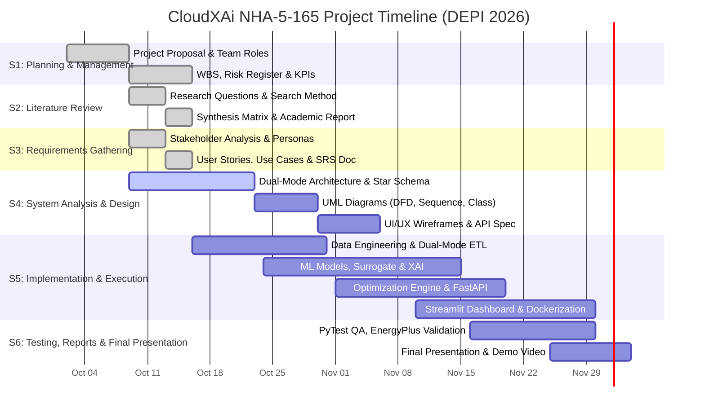

# Stage 1: Project Planning & Management
**ML Diploma Graduation Project | Deliverable Template v1.0**  
**Team Name:** CloudXAi  
**Team Code:** NHA-5-165  
**Project Title:** AI-Based Building Energy Performance Evaluation & Design Optimization  
**Submission Date:** October 2026  
**Document Version:** v1.0  

---

## 1. Project Summary

The **AI-Based Building Energy Performance Evaluation & Design Optimization** platform is an intelligent decision-support system designed for sustainable architects, energy consultants, and building performance engineers. The system resolves the trade-off between the computational slowness of physics-based engines (such as EnergyPlus) and the black-box limitations of standard empirical regression. 

The platform implements a **Dual-Mode Architecture** running seamlessly both on local developer workstations (via DuckDB, Parquet, MLflow, FastAPI, and Streamlit) and in enterprise cloud environments (via AWS S3, AWS Glue, Amazon Athena, and Amazon SageMaker). By combining early-stage parametric architectural data (768 benchmark archetypes) with massive operational time-series meter data (ASHRAE Great Energy Predictor III) and micro-climate weather conditions, CloudXAi enables:
* Real-time ($< 500\text{ ms}$) multi-target thermal load forecasting (Heating and Cooling loads).
* Weather-aware operational electricity consumption forecasting conforming to ASHRAE Guideline 14 standards.
* Explainable AI diagnostics using SHAP (Shapley Additive exPlanations) to isolate physical energy drivers.
* Automated multi-objective optimization (NSGA-II) mapping out the 3D Pareto Frontier across energy efficiency, thermal comfort, and construction costs.
* Physics-based ground truth verification against pre-simulated DOE Commercial Reference Buildings.

---

## 2. Team and Roles

The team members of **CloudXAi (NHA-5-165)** and their primary technical responsibilities are detailed below:

| Member Name | Role | Track | Core Responsibilities |
| :--- | :--- | :--- | :--- |
| **Ahmed AbdElrahman Ahmed** | **Team Leader** | AI / Machine Learning | • Project coordination, timeline tracking, and repository governance.<br>• Dual-mode architecture, local/AWS deployment setup, and CI/CD pipelines.<br>• Model integration, end-to-end testing, and quality control. |
| **Ahmed Mohamed Sayed Shehata** | **Team Member** | AI / Machine Learning | • Supervised regression modeling for Thermal Loads (LightGBM, XGBoost, MLP).<br>• Model tuning, cross-validation, and MLflow experiment tracking.<br>• Model evaluation against international benchmarks. |
| **Eman Abo Al Qassem Abo Al Hjajj Omar** | **Team Member** | AI / Machine Learning | • Time-series data preparation and operational energy forecasting pipeline.<br>• Data validation, unit harmonization, and Star Schema Parquet lakehouse.<br>• Meteorological and temporal feature engineering (lags, degree days). |
| **Manar Mahmoud Ahmed** | **Team Member** | AI / Machine Learning | • Multi-objective optimization engine (NSGA-II) implementation.<br>• FastAPI service development and model inference serving.<br>• Physics benchmark comparison against DOE reference models. |
| **Ali Ahmed Ali Elmeleegy** | **Team Member** | AI / Machine Learning | • Interactive Streamlit Digital Twin Dashboard development.<br>• Explainable AI (SHAP waterfall & force plots) integration.<br>• Automated executive PDF report generation and UI user testing. |

---

## 3. Objectives and Success Criteria

Each project objective is linked to rigorous, quantifiable Key Performance Indicators (KPIs):

| Objective ID | Objective Description | Target Metric / KPI | Threshold of Success |
| :--- | :--- | :--- | :--- |
| **O-01** | Build a robust, dual-mode Data Lakehouse supporting both local filesystem and AWS S3. | Pipeline Execution Time & Data Quality Score | • 100% schema validation compliance.<br>• Zero duplicate records or unhandled nulls.<br>• Local ETL pipeline runs in $< 60\text{ s}$ for benchmark dataset. |
| **O-02** | Develop high-accuracy ML surrogate models for Heating Load and Cooling Load prediction. | Coefficient of Determination ($R^2$), MAE | • $R^2 \ge 0.95$ on holdout test set.<br>• $\text{MAE} \le 1.25\text{ kWh/m}^2$.<br>• Inference latency $< 250\text{ ms}$ per design query. |
| **O-03** | Deliver weather-aware operational hourly energy forecasting on the ASHRAE GEPIII dataset. | ASHRAE Guideline 14 Metrics ($\text{CV(RMSE)}$, $\text{NMBE}$) | • $\text{CV(RMSE)} \le 15.0\%$ (Hourly).<br>• $\text{NMBE} \le \pm 5.0\%$.<br>• Temporal train/val/test split without look-ahead leakage. |
| **O-04** | Implement a multi-objective Pareto optimization engine for envelope parameter trade-offs. | Hypervolume Indicator, Convergence Speed | • Generate valid 50-point Pareto Frontier in $< 3.0\text{ s}$.<br>• 100% adherence to architectural boundary constraints. |
| **O-05** | Integrate Explainable AI (XAI) feature attribution and What-If simulation sandbox. | Explanation Completeness & User Latency | • SHAP local attribution computed in $< 300\text{ ms}$.<br>• What-If delta calculation ($\Delta\text{Energy}, \Delta\text{Cost}$) in real time. |
| **O-06** | Deploy responsive web dashboard and REST API with full containerization. | Availability, Latency, Test Coverage | • System Uptime $> 99.0\%$.<br>• PyTest unit/integration test coverage $\ge 85\%$.<br>• One-command execution via `docker-compose up`. |

---

## 4. Scope

### 4.1 In-Scope Deliverables
* **Data Engineering Subsystem:**
  * Raw ingestion modules for Tsanas & Xifara architectural data, ASHRAE GEPIII hourly meters, and NOAA/Site weather feeds.
  * Schema validation and unit conversion engine (Imperial to SI metric units: $\text{kWh/m}^2$, $^\circ\text{C}$, $\text{m/s}$).
  * Dimensional Parquet lakehouse schema (`dim_building`, `dim_weather`, `dim_design_envelope`, `fact_energy_meter`, `fact_simulation_benchmark`).
* **Machine Learning & Analytics Subsystem:**
  * Comparative benchmark of 5 algorithms (Linear/Ridge, Random Forest, LightGBM, XGBoost, Multi-Layer Perceptron).
  * Time-series feature engineering (cyclical hour/month encoding, rolling 24-hour weather means, heating/cooling degree days).
  * Residual error analysis for operational building behavior diagnosis.
  * TreeExplainer SHAP integration for global feature importance and local scenario attribution.
* **Optimization & Decision Support Subsystem:**
  * NSGA-II genetic algorithm optimizing window-to-wall ratio ($WWR$), orientation, compactness, and envelope U-values.
  * Interactive What-If simulation sandbox computing real-time energy differentials.
* **Software & Application Subsystem:**
  * Modular FastAPI REST backend exposing documented OpenAPI endpoints.
  * Multi-page Streamlit digital twin dashboard featuring interactive Plotly 2D/3D charts.
  * Automated PDF diagnostic summary report generator.
  * Containerized local deployment (Docker, Docker Compose) and AWS deployment scripts.

### 4.2 Out-of-Scope (Boundaries)
* Physical hardware sensor deployment or edge micro-controller IoT flashing.
* Structural engineering, foundation load-bearing calculations, or seismic risk modeling.
* Dynamic electricity tariff rate bidding or utility energy trading.
* Real-time 3D CFD airflow turbulence modeling inside rooms.

---

## 5. Work Breakdown Structure (WBS)

The project is structured hierarchically into 6 core work packages:

```
1.0 Project Management & Architecture
    1.1 Requirements gathering, stakeholder interview, and feasibility analysis
    1.2 Dual-mode architecture design (Local / AWS abstraction)
    1.3 Project tracking setup (GitHub Projects, Milestones, DoD)
2.0 Data Engineering & Lakehouse Pipeline
    2.1 Data acquisition (Architectural dataset, ASHRAE GEPIII, DOE models)
    2.2 Data validation, cleaning, and schema enforcement rules
    2.3 Dual-mode ETL engine (DuckDB / Polars for local; AWS Glue/Athena for cloud)
    2.4 Feature engineering (compactness, solar exposure, lag terms, degree days)
    2.5 Star Schema dimensional Parquet storage implementation
3.0 Machine Learning & Surrogate Modeling
    3.1 Thermal load multi-target regression pipeline & hyperparameter tuning
    3.2 Time-series weather-aware energy forecasting pipeline
    3.3 MLflow experiment tracking & model registry setup
    3.4 Model evaluation against ASHRAE Guideline 14 standards
    3.5 Model artifact serialization and inference wrapper
4.0 Explainability & Optimization Engine
    4.1 SHAP TreeExplainer integration for local & global feature attribution
    4.2 NSGA-II multi-objective optimization engine implementation (PyMoo)
    4.3 Pareto frontier filter and architectural constraint validator
    4.4 What-if scenario simulation engine (parameter delta calculator)
5.0 Application Layer & UI/UX Development
    5.1 FastAPI backend service development & Pydantic schema validation
    5.2 Streamlit interactive dashboard development (Overview, What-If, Pareto, XAI)
    5.3 Automated PDF diagnostic summary report generation module
    5.4 Docker and Docker-Compose containerization
6.0 Verification, Testing & Academic Reporting
    6.1 Automated unit, integration, and API contract testing (PyTest)
    6.2 Physics-based validation against DOE Reference Building benchmarks
    6.3 Technical documentation (SRS, SAD) and final presentation preparation
```

---

## 6. Milestones & Timeline (Gantt Chart Representation)

The project timeline strictly adheres to the official DEPI program schedule (October 2 – December 4, 2026):



### Milestone Summary Table

| Milestone ID | Stage / Deliverable | Due Date (DEPI) | Lead Responsible | Deliverable Artifact |
| :--- | :--- | :--- | :--- | :--- |
| **M-01** | Stage 1: Project Planning & Management | 16 Oct 2026 | Ahmed AbdElrahman Ahmed | `CloudXAi_S1_ProjectPlan_v1.docx` |
| **M-02** | Stage 2: Literature Review | 16 Oct 2026 | Ahmed Mohamed Sayed Shehata | `CloudXAi_S2_LiteratureReview_v1.docx` |
| **M-03** | Stage 3: Requirements Gathering | 16 Oct 2026 | Eman Abo Al Qassem / Ali Elmeleegy | `CloudXAi_S3_SRS_v1.docx` |
| **M-04** | Stage 4: System Analysis & Design | 06 Nov 2026 | Manar Mahmoud / Ahmed AbdElrahman | `CloudXAi_S4_SystemAnalysisAndDesign_v1.docx` |
| **M-05** | Stage 5: Core Implementation & Docker | 30 Nov 2026 | All Team Members | Full GitHub Codebase & Docker Image |
| **M-06** | Stage 6: Testing, Final Presentation & Report | 04 Dec 2026 | All Team Members | Final Slide Deck, PDF Report, Demo Video |

---

## 7. Tools and Collaboration

* **Version Control & Repository:** GitHub (`origin/main`, feature branching workflow `feature/feature-name`).
* **Data Processing & Local Storage:** DuckDB, Apache Arrow, Polars, MinIO / LocalStack.
* **Cloud Infrastructure (Optional / Cloud Profile):** AWS S3, AWS Glue, Amazon Athena, AWS SageMaker.
* **Machine Learning & Optimization:** Scikit-Learn, LightGBM, XGBoost, PyTorch, PyMoo (NSGA-II), Optuna.
* **Experiment Tracking:** MLflow (local artifact tracking server).
* **Application Framework:** FastAPI (REST API), Streamlit (Frontend Dashboard), Plotly (Charts).
* **Documentation & Diagrams:** Markdown, Mermaid.js, PlantUML, Draw.io.
* **Testing & Quality Assurance:** PyTest, Flake8, Black, Pydantic v2.

---

## 8. Communication Plan

To maintain momentum and early conflict resolution, Team CloudXAi adheres to the following communication cadence:

| Meeting Type | Frequency | Platform / Channel | Purpose & Agenda | Primary Output |
| :--- | :--- | :--- | :--- | :--- |
| **Daily Standup** | Mon–Thu (15 mins) | Discord / Slack | • What did you achieve yesterday?<br>• What will you work on today?<br>• Any technical blockers? | Discord task update log |
| **Sprint Review & Planning** | Every Friday (1 hour) | Google Meet | • Demonstrate weekly completed deliverables.<br>• Review open Pull Requests.<br>• Plan next week's WBS priorities. | GitHub Milestone update |
| **Mentor / Instructor Check-in** | Weekly (as scheduled) | Microsoft Teams | • Progress review with DEPI instructor.<br>• Feedback incorporation.<br>• Grade criteria verification. | Meeting action minutes |

---

## 9. Risk Register & Mitigation Plan

| Risk ID | Risk Description | Category | Likelihood | Impact | Mitigation Strategy | Contingency Plan |
| :--- | :--- | :--- | :--- | :--- | :--- | :--- |
| **R-01** | **AWS Cloud Billing / Service Limits:** Student AWS credits exhaust, preventing cloud execution. | Cost / Cloud | High | High | • Architect dual-mode execution using DuckDB, LocalStack, and local Parquet.<br>• Local mode is 100% functional without an active AWS account. | Fall back to local Docker demo; use cloud mode only for recorded benchmarks. |
| **R-02** | **Data Leakage in Time-Series:** Random cross-validation leaks future weather/meter data into past training. | Technical (ML) | Medium | High | • Strictly enforce chronological temporal split (e.g., Year 1 Train, Year 2 Val, Year 3 Test).<br>• Isolate unseen buildings into an out-of-sample test partition. | Automated data assertion checks in the PyTest ingestion test suite. |
| **R-03** | **EnergyPlus Simulation Bottleneck:** Running physical EnergyPlus simulations on local machines hangs or crashes due to missing OS libraries. | Technical (Physics) | High | Medium | • Use pre-simulated DOE Commercial Reference Building datasets.<br>• Build an offline ML surrogate model trained on validated benchmark runs. | Provide pre-computed simulation result lookup tables in `data/samples/`. |
| **R-04** | **Scope Creep (Too many ML tasks):** Attempting complex multi-layer transformers or real-time IoT causes delivery delays. | Management | Medium | High | • Pruned redundant BDG2 dataset; standardized on ASHRAE GEPIII.<br>• Demoted anomaly detection to a lightweight residual check.<br>• Enforce strict Definition of Done. | Cut non-essential stretch features immediately if timeline slips. |
| **R-05** | **Multi-Objective Optimization Latency:** NSGA-II takes too long ($> 10\text{ s}$) to generate Pareto frontier during user interaction. | Performance | Medium | Medium | • Optimize surrogate inference vectorization using NumPy and LightGBM C-APIs.<br>• Cache frequently queried Pareto fronts. | Pre-generate and cache standard archetypal Pareto sets for quick exploration. |
| **R-06** | **Incompatible Unit Standards:** Imperial units (Btu, sq ft, °F) in raw datasets mixed with Metric units ($W/m^2$, $m^2$, °C). | Data Quality | High | High | • Implement a dedicated unit standardization layer during ETL extraction.<br>• Assert unit validation rules before writing to Curated Parquet. | Automated pipeline rejects any batch failing unit consistency tests. |

---

## 10. Definition of Done (DoD)

A task or work package is considered **Done** only when all the following criteria are satisfied:
1. **Code Standards:** Code adheres to PEP 8, formatted via `black`, linted with `flake8`, and has meaningful docstrings for all classes and functions.
2. **Automated Testing:** Unit and integration tests written in `pytest` with $\ge 85\%$ test coverage across critical data processing and inference modules.
3. **Reproducibility:** Code runs locally without manual path hacking; environment configuration managed cleanly through `.env` and `config.yaml`.
4. **Documentation:** Documentation updated in Markdown and linked from `README.md`; API endpoints documented via OpenAPI / Swagger.
5. **Code Review:** Pull Request approved by the Team Leader and at least one peer reviewer before merging into `main`.
