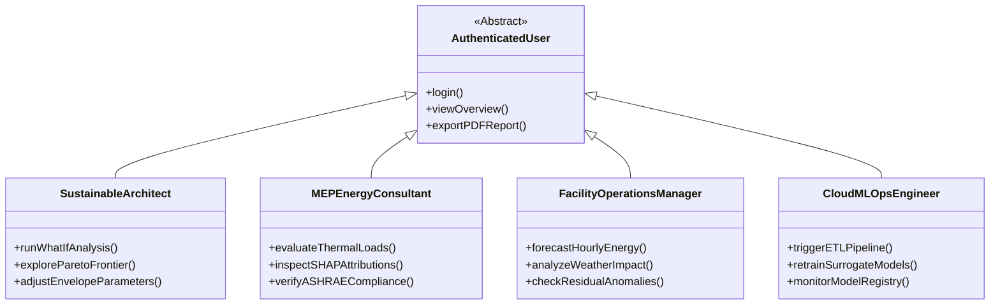

# Stage 3: User Stories & Use Cases
**ML Diploma Graduation Project | Requirements Engineering**  
**Team Name:** CloudXAi  
**Team Code:** NHA-5-165  
**Project Title:** AI-Based Building Energy Performance Evaluation & Design Optimization  
**Document Version:** v1.0  

---

## 1. System Actors

The platform identifies four primary human actors and three automated system actors:



### System / Automated Actors:
* **SA-01 (ML Inference Service):** Vectorized LightGBM/XGBoost inference workers serving predictions via FastAPI.
* **SA-02 (Pareto Optimization Worker):** Evolutionary NSGA-II solver generating multi-objective candidate sets.
* **SA-03 (Dual-Mode Data Lake):** Abstracted Parquet storage backend (DuckDB local / AWS S3 + Athena cloud).

---

## 2. User Stories

User stories follow the standard agile format:  
`As a <role>, I want <goal>, so that <business benefit>.`  
Each story includes explicit **Acceptance Criteria (AC)** defined in the `Given-When-Then` format and an assigned priority (**Critical**, **High**, **Medium**).

### Subsystem 1: Early-Stage Design & What-If Simulation
* **US-01 (Parametric Design Evaluation):**  
  * *Story:* As a Sustainable Architect, I want to input building geometric parameters (compactness, surface area, wall area, roof area, height, orientation, glazing ratio) into an interactive form, so that I can instantly view estimated Heating Load and Cooling Load.
  * *Priority:* **Critical**
  * *Acceptance Criteria:*
    * *Given* valid geometric inputs within physical bounds,
    * *When* I click "Evaluate Performance",
    * *Then* the system returns predicted Heating and Cooling loads in $< 500\text{ ms}$ with $95\%$ confidence intervals.
* **US-02 (Real-Time What-If Sandbox):**  
  * *Story:* As a Sustainable Architect, I want to adjust sliders for window-to-wall ratio and building orientation, so that I can immediately observe the differential change ($\Delta\text{kWh/m}^2$) in energy demand.
  * *Priority:* **Critical**
  * *Acceptance Criteria:*
    * *Given* an active baseline design,
    * *When* I drag the south glazing slider from $20\%$ to $40\%$,
    * *Then* the UI updates both numerical deltas and comparative bar charts without a full page refresh.
* **US-03 (Envelope Glazing Distribution):**  
  * *Story:* As a Sustainable Architect, I want to vary the glazing distribution across North, South, East, and West facades independently, so that I can evaluate passive solar heat gain strategies.
  * *Priority:* **High**
  * *Acceptance Criteria:*
    * *Given* four directional glazing inputs summing to a valid envelope ratio,
    * *When* I submit the configuration,
    * *Then* the system accurately reflects orientation-specific thermal impacts.

### Subsystem 2: Multi-Objective Design Optimization
* **US-04 (Pareto Frontier Generation):**  
  * *Story:* As a Sustainable Architect, I want to execute a multi-objective optimization run that balances minimizing heating load, minimizing cooling load, and minimizing envelope construction cost, so that I can review non-dominated trade-off designs.
  * *Priority:* **Critical**
  * *Acceptance Criteria:*
    * *Given* defined optimization bounds and architectural constraints,
    * *When* I trigger the NSGA-II optimizer,
    * *Then* the system generates and visualizes a 50-point Pareto frontier in an interactive 2D/3D Plotly chart within 3 seconds.
* **US-05 (Pareto Point Inspection & Selection):**  
  * *Story:* As an MEP Energy Consultant, I want to click any point along the Pareto curve, so that I can inspect its complete parameter breakdown and export its configuration directly to CAD/BIM.
  * *Priority:* **High**
  * *Acceptance Criteria:*
    * *Given* an active Pareto scatter plot,
    * *When* I click on point P-14,
    * *Then* a detailed parameter inspector panel reveals its exact dimensions, orientation, glazing, and predicted performance.
* **US-06 (Constraint-Bounded Optimization):**  
  * *Story:* As a Sustainable Architect, I want to enforce strict envelope budget ceilings and minimum daylighting thresholds during optimization, so that the algorithm only produces commercially viable designs.
  * *Priority:* **High**
  * *Acceptance Criteria:*
    * *Given* a maximum envelope cost constraint of $\$150/\text{m}^2$,
    * *When* the optimizer runs,
    * *Then* zero candidates violating the constraint are returned in the final population.

### Subsystem 3: Operational Weather-Aware Energy Forecasting
* **US-07 (Hourly Weather-Aware Forecasting):**  
  * *Story:* As a Facility Operations Manager, I want to upload a 7-day hourly weather forecast (temperature, humidity, wind, solar radiation) for a specific site, so that I can predict hourly commercial electricity consumption ($\text{kWh}$).
  * *Priority:* **Critical**
  * *Acceptance Criteria:*
    * *Given* a valid site ID and weather time-series CSV,
    * *When* I trigger the forecasting engine,
    * *Then* an hourly energy consumption curve is rendered with peak-demand hours highlighted.
* **US-08 (Degree-Day Heating/Cooling Analysis):**  
  * *Story:* As an MEP Energy Consultant, I want the system to automatically compute Heating Degree Days (HDD) and Cooling Degree Days (CDD), so that weather severity can be correlated with historical baseline consumption.
  * *Priority:* **Medium**
  * *Acceptance Criteria:*
    * *Given* hourly dry-bulb temperature data,
    * *When* the data is processed,
    * *Then* daily HDD and CDD are computed against a standard $18.3^\circ\text{C}$ base temperature.
* **US-09 (Operational Residual Anomaly Check):**  
  * *Story:* As a Facility Operations Manager, I want to compare actual historical smart meter telemetry against the model's predicted baseline, so that operational anomalies or HVAC scheduling malfunctions can be flagged.
  * *Priority:* **High**
  * *Acceptance Criteria:*
    * *Given* actual meter readings and weather inputs,
    * *When* the residual exceeds a $2.5\sigma$ standard deviation threshold,
    * *Then* the system flags the anomalous timestamps with a visual alert.

### Subsystem 4: Explainable AI & Decision Diagnostics
* **US-10 (Global Feature Importance):**  
  * *Story:* As an MEP Energy Consultant, I want to view a global SHAP summary plot ranking all input parameters by their impact on heating and cooling loads, so that I can confirm physical thermodynamic consistency.
  * *Priority:* **High**
  * *Acceptance Criteria:*
    * *Given* the trained surrogate model,
    * *When* I navigate to the "Model Diagnostics" tab,
    * *Then* a SHAP bee-swarm plot ranks features by mean absolute Shapley value ($|\text{SHAP}|$).
* **US-11 (Local Instance Explanation - Waterfall Plot):**  
  * *Story:* As a Sustainable Architect, I want to see a waterfall breakdown of a single building design showing how each parameter pushed the prediction higher or lower than the baseline, so that I can explain the result to my client.
  * *Priority:* **Critical**
  * *Acceptance Criteria:*
    * *Given* an evaluated design configuration,
    * *When* I click "Explain Prediction",
    * *Then* a SHAP waterfall plot displays the positive and negative contributions of each parameter summing to the final predicted load.

### Subsystem 5: Data Engineering & System Portability
* **US-12 (Dual-Mode Execution Toggle):**  
  * *Story:* As a Cloud/MLOps Engineer, I want the system to run locally without internet connectivity or AWS credentials when `EXECUTION_MODE=local`, and switch to AWS S3/Athena when `EXECUTION_MODE=aws`, so that the project can be demonstrated offline.
  * *Priority:* **Critical**
  * *Acceptance Criteria:*
    * *Given* `EXECUTION_MODE=local` in `.env`,
    * *When* the pipeline executes,
    * *Then* DuckDB queries local Parquet files without attempting AWS network connections.
* **US-13 (Automated Data Ingestion & Validation):**  
  * *Story:* As a Data Engineer, I want an automated ingestion script that checks incoming raw files for null values, duplicate timestamps, and out-of-bounds physical values, so that corrupted data is quarantined before ETL.
  * *Priority:* **Critical**
  * *Acceptance Criteria:*
    * *Given* a raw dataset file,
    * *When* ingestion runs,
    * *Then* invalid records are logged into `logs/validation/` and the pipeline maintains clean Parquet tables.
* **US-14 (Automated PDF Report Generation):**  
  * *Story:* As an MEP Energy Consultant, I want to generate a formal PDF report summarizing the building design, predicted thermal loads, SHAP waterfall explanation, and Pareto optimization alternatives with a single click.
  * *Priority:* **High**
  * *Acceptance Criteria:*
    * *Given* an active evaluated design,
    * *When* I click "Export PDF Report",
    * *Then* a formatted executive PDF report is downloaded within 3 seconds.

---

## 3. Formal Use Cases

```mermaid
graph TD
    User((Authenticated User))
    Architect((Sustainable Architect))
    Consultant((MEP Consultant))
    Facility((Facility Manager))
    MLOps((Cloud MLOps Eng))

    User <|-- Architect
    User <|-- Consultant
    User <|-- Facility
    User <|-- MLOps

    Architect --> UC01[UC-01: Evaluate Architectural Performance]
    Architect --> UC02[UC-02: Run What-If Simulation]
    Architect --> UC03[UC-03: Execute Pareto Optimization]

    Consultant --> UC04[UC-04: Generate SHAP Feature Attribution]
    Consultant --> UC05[UC-05: Verify Physics Benchmark with DOE]
    Consultant --> UC06[UC-06: Export Executive PDF Report]

    Facility --> UC07[UC-07: Forecast Operational Hourly Energy]
    Facility --> UC08[UC-08: Check Residual Anomaly Diagnostics]

    MLOps --> UC09[UC-09: Execute Dual-Mode ETL Pipeline]
    MLOps --> UC10[UC-10: Retrain & Register Surrogate Models]
    MLOps --> UC11[UC-11: Query Curated Data Lakehouse via SQL]
    MLOps --> UC12[UC-12: Deploy Containerized Application]
```

### Detailed Use Case Specifications (Sample Core Use Cases)

#### Use Case UC-01: Evaluate Architectural Performance
* **Primary Actor:** Sustainable Architect / MEP Energy Consultant.
* **Preconditions:** The FastAPI inference backend is running and the ML surrogate model artifacts are loaded.
* **Trigger:** The user inputs building geometry parameters into the web dashboard and clicks "Evaluate Performance".
* **Main Success Scenario:**
  1. System validates that all numerical inputs are within physical ranges (e.g., Compactness $\in [0.6, 1.0]$, Glazing Ratio $\in [0.0, 0.5]$).
  2. Frontend sends an asynchronous `POST /api/v1/predict/thermal-load` request to the backend.
  3. ML inference service constructs the feature vector and passes it through the trained LightGBM/XGBoost ensemble.
  4. Backend returns predicted Heating Load ($\text{kWh/m}^2$) and Cooling Load ($\text{kWh/m}^2$).
  5. UI displays KPI metric cards, comparison against benchmark baselines, and thermal efficiency ratings.
* **Alternate Flows:**
  * *4a. Input out of physical bounds:* System rejects the request with HTTP 422 and displays a clear inline error explaining the valid range.
* **Postconditions:** Prediction results are cached in the session state for downstream What-If and SHAP analysis.

#### Use Case UC-03: Execute Multi-Objective Pareto Optimization
* **Primary Actor:** Sustainable Architect.
* **Preconditions:** Baseline architectural parameters and boundary constraints are defined.
* **Trigger:** User selects optimization objectives (Minimize Energy, Minimize Cost, Maximize Compactness) and clicks "Find Optimal Designs".
* **Main Success Scenario:**
  1. System initializes the NSGA-II evolutionary algorithm with a population size of 100 and 50 generations.
  2. For each candidate design generated by genetic crossover/mutation, the ML surrogate model computes instant objective fitness values.
  3. The algorithm evaluates constraints (e.g., maximum budget, minimum daylighting).
  4. Non-dominated sorting identifies the Pareto Rank 1 frontier.
  5. The resulting optimal design points are returned and rendered on an interactive 3D Plotly surface.
  6. User interacts with the Pareto plot to select and compare specific trade-off designs.
* **Alternate Flows:**
  * *3a. Conflicting constraints make population infeasible:* System displays a warning advising the user to relax specific parameter constraints.
* **Postconditions:** Selected Pareto candidates can be saved or exported for EnergyPlus physics verification.

#### Use Case UC-04: Generate SHAP Feature Attribution
* **Primary Actor:** MEP Energy Consultant / Sustainable Architect.
* **Preconditions:** A specific building design has been evaluated in UC-01.
* **Trigger:** User clicks the "Explain Factors (SHAP)" button in the diagnostics panel.
* **Main Success Scenario:**
  1. Backend passes the design vector to the pre-computed SHAP `TreeExplainer`.
  2. Individual Shapley values are calculated for each of the 8 geometric and envelope features.
  3. The baseline expected value ($E[f(x)]$) and individual feature contributions ($\phi_i$) are returned.
  4. UI renders an interactive waterfall chart showing which features increased or decreased the thermal load.
  5. A plain-English narrative explanation is automatically synthesized (e.g., *"South-facing glazing of 40% increased cooling load by 4.2 kWh/m²"*).
* **Postconditions:** The visual explanation is attached to the session state for inclusion in the PDF export.

#### Use Case UC-09: Execute Dual-Mode ETL Pipeline
* **Primary Actor:** Cloud / MLOps Engineer.
* **Preconditions:** Raw datasets are present in local storage (`data/raw/`) or cloud S3 (`s3://.../raw/`).
* **Trigger:** Execution command `python -m etl.run_pipeline` or scheduled cron trigger.
* **Main Success Scenario:**
  1. Pipeline detects the execution environment via `EXECUTION_MODE`.
  2. Schema validation engine inspects column names, types, null percentages, and physical ranges.
  3. Transformation engine cleans data, standardizes units to SI, and calculates temporal lag/rolling features.
  4. Curated data is written to partitioned columnar Parquet files (`data/curated/` or `s3://.../curated/`).
  5. In local mode, DuckDB registers the Parquet tables; in cloud mode, AWS Glue Crawler updates the Data Catalog.
  6. Pipeline execution log and summary statistics are saved.
* **Postconditions:** Processed data is ready for model training and Athena/DuckDB SQL exploration.
