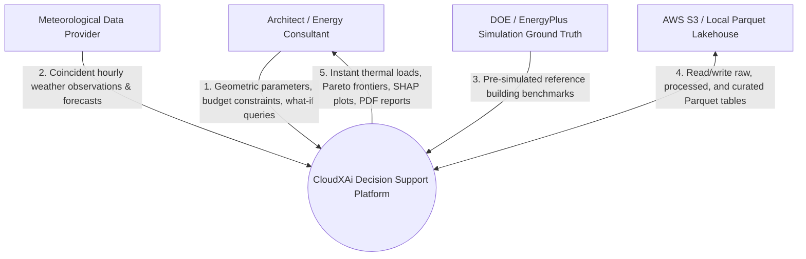
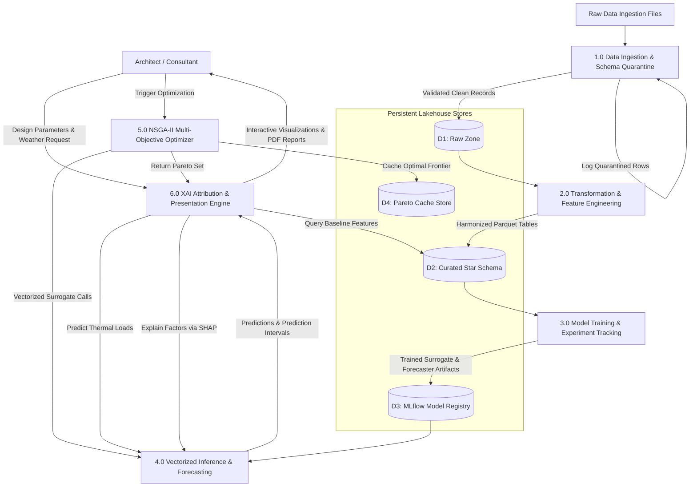
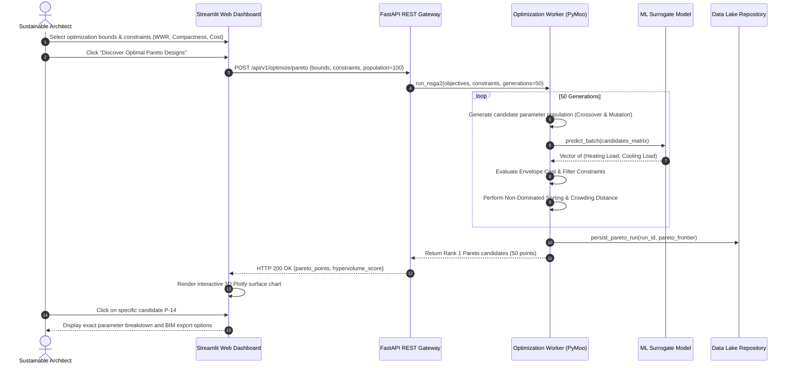
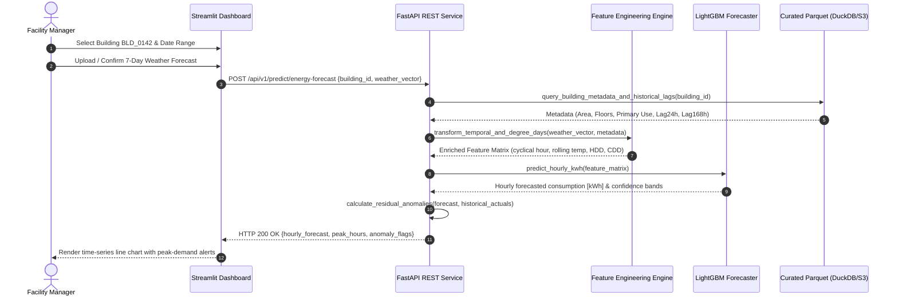
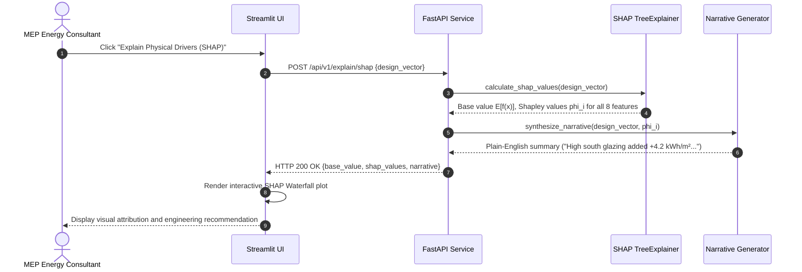
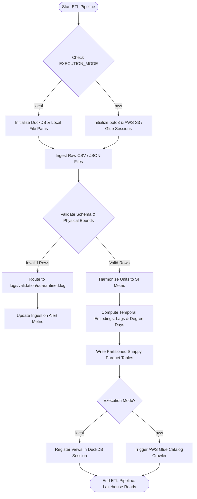
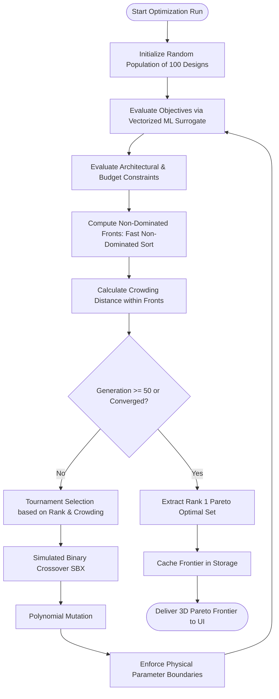
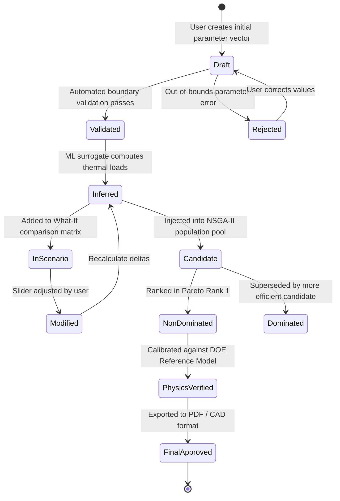
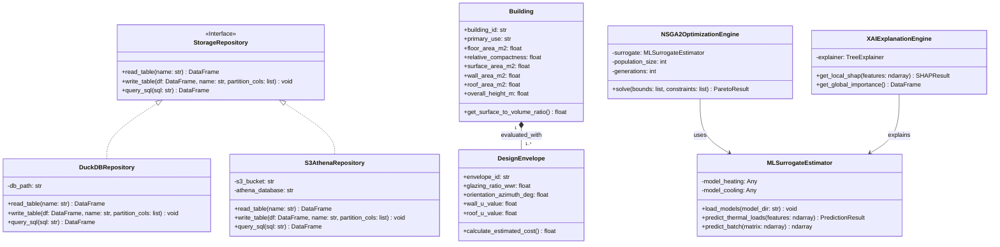

# Stage 4: Data Flow & System Behavior Specification
**ML Diploma Graduation Project | System Analysis & Design**  
**Team Name:** CloudXAi  
**Team Code:** NHA-5-165  
**Project Title:** AI-Based Building Energy Performance Evaluation & Design Optimization  
**Document Version:** v1.0  

---

## 1. Data Flow Diagrams (DFD)

### 1.1 Context Level 0 DFD

The Level 0 context diagram defines the interactions between the **CloudXAi System Boundary** and all external entities:

---

### 1.2 DFD Level 1: Subsystem Decomposition

The Level 1 DFD decomposes the system into six interconnected processes and persistent data stores:

---

## 2. Sequence Diagrams

### 2.1 SD-01: End-to-End Design Optimization & Pareto Exploration
Illustrates the chronological interaction flow when an architect executes a multi-objective optimization run:

---

### 2.2 SD-02: Weather-Aware Operational Energy Forecasting
Illustrates how coincident weather feeds drive multi-horizon operational building energy prediction:

---

### 2.3 SD-03: SHAP Feature Attribution Diagnostics
Illustrates how the system calculates and delivers local explainability for an evaluated design:

---

## 3. Activity Diagrams

### 3.1 AD-01: Dual-Mode ETL & Lakehouse Processing Pipeline

---

### 3.2 AD-02: NSGA-II Multi-Objective Optimization Loop

---

## 4. State Machine Diagram

### SMD-01: Building Design Configuration Lifecycle

The lifecycle of an architectural design candidate within the system progresses through six defined states:

---

## 5. Class Diagram (Domain Model & Software Architecture)

