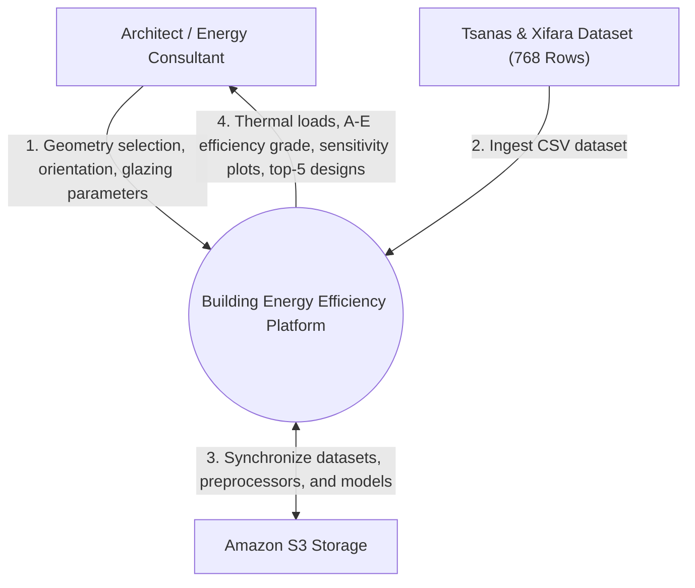
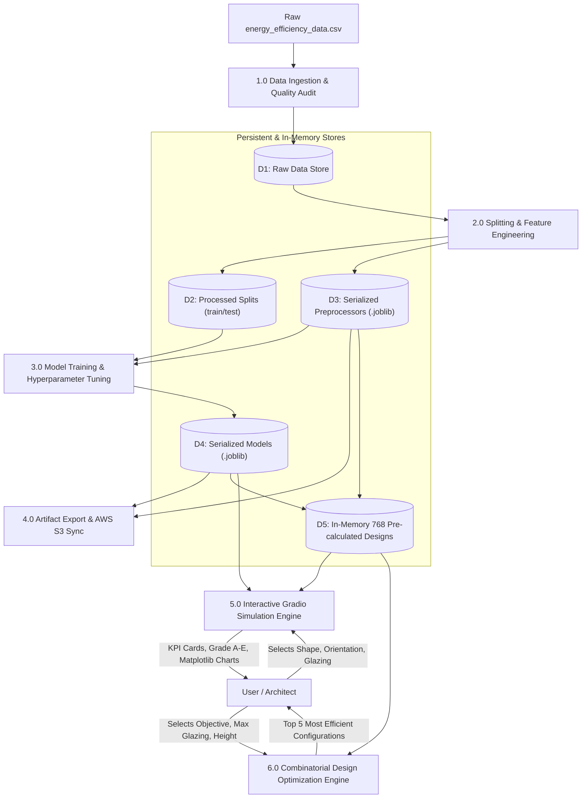
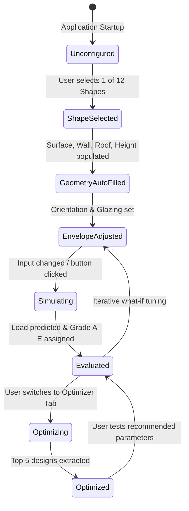

# Stage 4: Data Flow & System Behavior Specification
**ML Diploma Graduation Project | System Analysis & Design**  
**Team Name:** CloudXAi  
**Team Code:** NHA-5-165  
**Project Title:** Building Energy Efficiency: Heating & Cooling Load Prediction  
**Document Version:** v2.0 (Reconstructed)  

---

## 1. Data Flow Diagrams (DFD)

### 1.1 Context Level 0 DFD
The Level 0 context diagram defines the high-level boundary of the **Building Energy Efficiency System** and its interactions with human users and external cloud services:



---

### 1.2 DFD Level 1: Subsystem Process Decomposition
The Level 1 diagram decomposes the system into six sequential and operational processes:



---

## 2. System Behavior: Sequence Diagrams

### 2.1 Sequence Diagram: Live Building Thermal Load Simulation
This sequence illustrates what occurs when an architect adjusts building design parameters in the Gradio web UI:

```mermaid
sequenceDiagram
    autonumber
    actor User as Architect / User
    participant UI as Gradio Frontend (app.py)
    participant Sim as Simulation Engine
    participant Pre as Preprocessor Pipeline (joblib)
    participant ModH as Heating Model (XGBoost)
    participant ModC as Cooling Model (XGBoost)
    participant Chart as Plotting Engine (Matplotlib)

    User->>UI: Selects Building Shape (e.g., Shape 5, Compactness 0.76)
    UI->>UI: Auto-fills Surface Area, Wall Area, Roof Area, Height
    User->>UI: Adjusts Orientation & Glazing Area Ratio
    User->>UI: Triggers Simulation (click or on-change)
    UI->>Sim: simulate(shape_i, ori, ga, gd)
    Sim->>Pre: transform(input_dataframe)
    Pre-->>Sim: Processed feature vector X
    Sim->>ModH: predict(X)
    ModH-->>Sim: Heating Load (Y1)
    Sim->>ModC: predict(X)
    ModC-->>Sim: Cooling Load (Y2)
    Sim->>Sim: Total = Y1 + Y2; Grade = grade(Total)
    Sim->>Chart: bar_fig(Y1, Y2, benchmarks)
    Chart-->>Sim: Stacked comparison bar chart
    Sim->>Chart: sens_fig(shape, ori, ga, gd)
    Chart-->>Sim: Glazing sensitivity curve
    Sim-->>UI: Render KPI Cards (Y1, Y2, Total, Grade), HTML Geo, Plots
    UI-->>User: Visual feedback displayed in browser (< 100 ms)
```

---

### 2.2 Sequence Diagram: Automated 768-Design Optimization
This sequence illustrates how the Design Optimizer instantly extracts the top-5 designs meeting user constraints:

```mermaid
sequenceDiagram
    autonumber
    actor Consultant as Energy Consultant
    participant UI as Gradio Frontend (app.py)
    participant Opt as Optimizer Engine
    participant Cache as In-Memory 768 Design DataFrame

    Consultant->>UI: Navigates to "🎯 Design Optimizer" tab
    Consultant->>UI: Selects Objective ("Total energy", "Heating only", "Cooling only")
    Consultant->>UI: Selects Constraints (Max Glazing = 0.25, Height = "Any")
    Consultant->>UI: Clicks "Find best designs"
    UI->>Opt: optimize(objective, max_glazing, height_filter)
    Opt->>Cache: Query filtered rows: (Glazing_Area <= max_glazing) & (Height == filter)
    Cache-->>Opt: Filtered subset of candidate designs
    Opt->>Opt: Sort ascending by selected objective
    Opt->>Opt: Extract top 5 rows & format columns
    Opt-->>UI: Return formatted Dataframe table
    UI-->>Consultant: Display Top-5 optimal designs with energy scores
```

---

## 3. State Machine Diagram: Architectural Design Lifecycle


