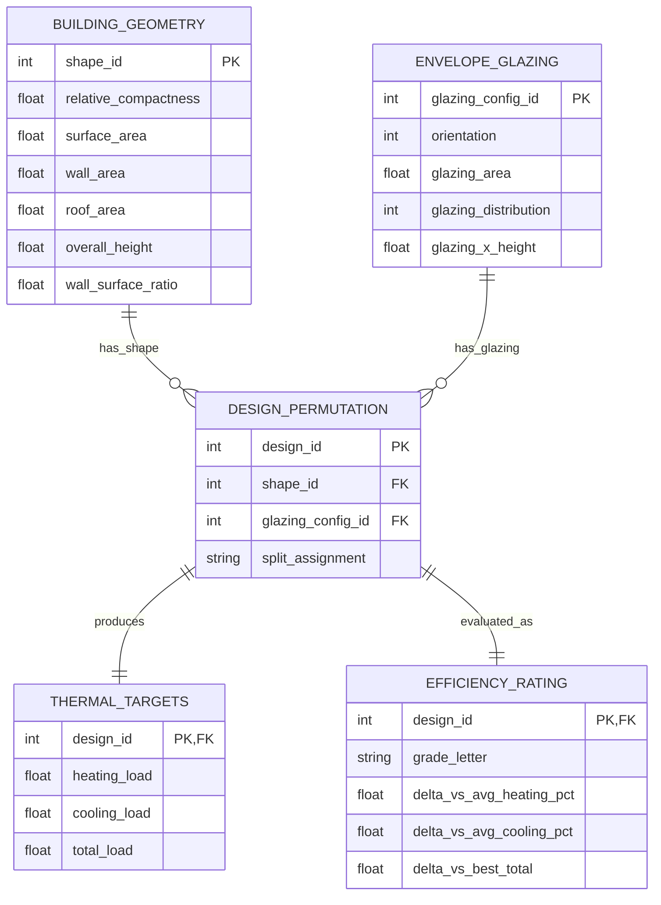

# Stage 4: Database Design & Data Modeling Specification
**ML Diploma Graduation Project | System Analysis & Design**  
**Team Name:** CloudXAi  
**Team Code:** NHA-5-165  
**Project Title:** Building Energy Efficiency: Heating & Cooling Load Prediction  
**Document Version:** v2.0 (Reconstructed)  

---

## 1. Data Strategy & Architectural Rationale

In the **Building Energy Efficiency Platform**, data modeling serves as the analytical foundation connecting raw architectural envelope parameters to multi-target thermal performance predictions. 

Unlike transactional e-commerce or unstructured media systems, building energy machine learning relies on **rigorous parametric feature modeling**, where geometric variables exhibit strong physical interactions and multicollinearity. The data architecture is structured across four standardized layers:

1. **Raw Ingestion Layer:** The canonical 768-sample Tsanas & Xifara dataset stored as immutable CSV format (`data/energy_efficiency_data.csv` and AWS S3).
2. **Engineered Feature Layer:** Mathematical transformation computing physically meaningful interaction terms ($\text{Wall\_Surface\_Ratio}$ and $\text{Glazing\_x\_Height}$) within a reproducible scikit-learn pipeline.
3. **Partitioned Storage Layer:** Leak-free 80/20 train/test split data (`processed/train.csv`, `processed/test.csv`) and fitted transformer pipelines (`processed/preprocessor_tree.joblib`, `processed/preprocessor_linear.joblib`).
4. **Analytical Design Lake Layer:** An indexed 768-row combinatorial design matrix cached in-memory within the Gradio simulator (`app.py`), enabling instantaneous sub-millisecond filtering, ranking, and sensitivity analysis.

---

## 2. Comprehensive Data Dictionary

The dataset comprises 768 simulated residential building archetypes generated using the EnergyPlus simulation engine, featuring 8 input features and 2 regression target variables:

| Column Name | Mathematical Symbol | Data Type | Physical Unit | Permissible Range / Values | Thermodynamic Description & Role |
| :--- | :---: | :---: | :---: | :---: | :--- |
| `Relative_Compactness` | $X_1$ | `float64` | Ratio (dimensionless) | $[0.62, 0.98]$ | Ratio of the building's surface-to-volume ratio compared to a reference cube. Higher compactness minimizes exposed surface area relative to conditioned volume, reducing heat loss. |
| `Surface_Area` | $X_2$ | `float64` | $\text{m}^2$ | $[514.50, 808.50]$ | Total exterior boundary surface area (walls, roof, floor). Primary multiplier for conductive thermal transmission. |
| `Wall_Area` | $X_3$ | `float64` | $\text{m}^2$ | $[245.00, 416.50]$ | Total vertical opaque exterior wall area through which conductive and convective heat transfer occurs. |
| `Roof_Area` | $X_4$ | `float64` | $\text{m}^2$ | $[110.25, 220.50]$ | Total horizontal ceiling/roof surface area. Strongly coupled with building height and compactness. |
| `Overall_Height` | $X_5$ | `float64` | Meters ($\text{m}$) | $\{3.5, 7.0\}$ | Building vertical height (single-story $3.5\text{ m}$ vs. two-story $7.0\text{ m}$). Dictates thermal stack effect and vertical exposure. |
| `Orientation` | $X_6$ | `int64` | Cardinal Code | $\{2, 3, 4, 5\}$ | Facade orientation: $2 = \text{North}$, $3 = \text{East}$, $4 = \text{South}$, $5 = \text{West}$. Modulates incident solar angles throughout daylight hours. |
| `Glazing_Area` | $X_7$ | `float64` | Ratio of floor area | $\{0.0, 0.10, 0.25, 0.40\}$ | Window glazing area as a percentage of conditioned floor area. Directly controls direct solar heat gain and radiative window transmission. |
| `Glazing_Area_Distribution` | $X_8$ | `int64` | Categorical Code | $\{0, 1, 2, 3, 4, 5\}$ | Spatial arrangement of fenestration: $0 = \text{None (No glazing)}$, $1 = \text{Uniform}$, $2 = \text{North}$, $3 = \text{South}$, $4 = \text{East}$, $5 = \text{West}$. |
| `Heating_Load` | $Y_1$ | `float64` | $\text{kWh/m}^2$ | $[6.01, 43.10]$ | **Target 1:** Thermal energy demand required to maintain indoor heating setpoint during cold periods. |
| `Cooling_Load` | $Y_2$ | `float64` | $\text{kWh/m}^2$ | $[10.90, 48.03]$ | **Target 2:** Thermal energy demand required to maintain indoor cooling setpoint during warm periods. |

---

## 3. Data Quality & Statistical Profile

Automated verification of the raw data (`data_quality_report.csv`) confirms flawless data integrity:

| Metric | Measured Value | Validation Status | Implication for Modeling |
| :--- | :---: | :---: | :--- |
| **Total Record Count** | 768 rows | Verified | Sufficient for low-variance ensemble regression. |
| **Missing Values (Nulls)** | 0 (0.0%) | PASS | No statistical imputation required. |
| **Duplicate Rows** | 0 (0.0%) | PASS | No deduplication bias or data leakage. |
| **Negative Values** | 0 (0.0%) | PASS | All physical geometry and load dimensions strictly positive. |
| **Outliers (IQR Rule)** | 0 outliers across all columns | PASS | Extreme stability; no clipping or trimming needed. |

### Discrete Geometry Cardinality
The 768 records are generated from a systematic parametric grid:
$$\text{Total Combinations} = 12\text{ Building Shapes} \times 4\text{ Orientations} \times \left(1\text{ (Glazing 0.0)} + 3\text{ (Glazing } > 0) \times 5\text{ Distributions}\right) = 12 \times 4 \times 16 = 768$$
* **Canonical Building Shapes:** Exactly 12 unique combinations of $(X_1, X_2, X_3, X_4, X_5)$.
* **Height Split:** Exactly 384 buildings with $\text{Height} = 3.5\text{ m}$ and 384 buildings with $\text{Height} = 7.0\text{ m}$.

---

## 4. Feature Engineering & Mathematical Relationships

Two domain-specific features are engineered to capture compound thermodynamic phenomena:

### 1. Wall-to-Surface Area Ratio ($\text{Wall\_Surface\_Ratio}$)
$$\text{Wall\_Surface\_Ratio} = \frac{\text{Wall\_Area}}{\text{Surface\_Area}} = \frac{X_3}{X_2}$$
* **Thermodynamic Justification:** Measures the proportion of envelope exposure that is vertical wall versus horizontal roof. Roofs experience zenith solar radiation, whereas walls receive directional irradiance influenced by orientation.

### 2. Glazing-Height Interaction ($\text{Glazing\_x\_Height}$)
$$\text{Glazing\_x\_Height} = \text{Glazing\_Area} \times \text{Overall\_Height} = X_7 \times X_5$$
* **Thermodynamic Justification:** The absolute glass surface area scaling is proportional to building height; tall two-story structures have double the vertical facade area, magnifying the thermal gain from a given glazing ratio.

### 3. Total Thermal Load ($Y_{\text{total}}$)
$$Y_{\text{total}} = Y_1 + Y_2 = \text{Heating\_Load} + \text{Cooling\_Load}$$
* Used in the Gradio simulator to compute the overall annual energy impact and derive energy ratings.

---

## 5. Entity-Relationship & Relational Schema Design

While the project utilizes CSV and in-memory Pandas dataframes for high-performance ML inference, the relational representation below illustrates the schema implemented across storage tiers:



---

## 6. Energy Efficiency Rating Classification Scheme

In the presentation and simulator layer, buildings are assigned an **Energy Efficiency Rating** from **A** (most efficient) to **E** (least efficient), modeled as quintiles ($20^{\text{th}}, 40^{\text{th}}, 60^{\text{th}}, 80^{\text{th}}$ percentiles) of total thermal load across the complete dataset:

$$\text{Quintile Thresholds } Q = [Q_{0.20}, Q_{0.40}, Q_{0.60}, Q_{0.80}]$$

| Rating Grade | Percentile Range | Total Load Range ($\text{kWh/m}^2$) | Visual Indicator | Efficiency Interpretation |
| :---: | :---: | :---: | :---: | :--- |
| **A** | $0^{\text{th}} - 20^{\text{th}}$ Percentile | Total Load $\le 31.8\text{ kWh/m}^2$ | `#16a34a` (Green) | **Ultra-High Efficiency:** Optimal compactness, low roof area, single-story, minimal heating demand. |
| **B** | $20^{\text{th}} - 40^{\text{th}}$ Percentile | $31.8 < \text{Total} \le 40.2\text{ kWh/m}^2$ | `#65a30d` (Lime) | **High Efficiency:** Favorable geometry with moderate glazing ratios. |
| **C** | $40^{\text{th}} - 60^{\text{th}}$ Percentile | $40.2 < \text{Total} \le 58.6\text{ kWh/m}^2$ | `#ca8a04` (Amber) | **Moderate Efficiency:** Standard residential performance; baseline archetype. |
| **D** | $60^{\text{th}} - 80^{\text{th}}$ Percentile | $58.6 < \text{Total} \le 72.1\text{ kWh/m}^2$ | `#ea580c` (Orange) | **Low Efficiency:** Tall two-story building with high exterior surface exposure. |
| **E** | $80^{\text{th}} - 100^{\text{th}}$ Percentile | $\text{Total} > 72.1\text{ kWh/m}^2$ | `#dc2626` (Red) | **Poor Efficiency:** Maximum glazing ratio ($40\%$), high surface area, substantial cooling/heating loss. |

---

## 7. Multicollinearity & Feature Correlation Analysis

Mathematical inter-dependence among geometric dimensions is a defining characteristic of this dataset:

```
Correlation Matrix (Key Interactions):
                           Relative_Comp  Surface_Area  Roof_Area  Overall_Height  Heating_Load  Cooling_Load
Relative_Compactness           1.00          -0.99        -0.87         0.83           0.62          0.63
Surface_Area                  -0.99           1.00         0.88        -0.86          -0.66         -0.67
Roof_Area                     -0.87           0.88         1.00        -0.97          -0.86         -0.86
Overall_Height                 0.83          -0.86        -0.97         1.00           0.89          0.90
Orientation                    0.00           0.00         0.00         0.00           0.00          0.01
Glazing_Area                   0.00           0.00         0.00         0.00           0.27          0.21
Heating_Load                   0.62          -0.66        -0.86         0.89           1.00          0.98
Cooling_Load                   0.63          -0.67        -0.86         0.90           0.98          1.00
```

### Analytical Insights:
1. **Collinearity of Geometry ($|r| > 0.85$):** `Surface_Area`, `Roof_Area`, and `Relative_Compactness` are nearly collinear. While this induces matrix instability in Ordinary Least Squares (reducing Linear Regression test $R^2$), tree-based models (XGBoost, Random Forest) greedily split on the most informative variable without variance inflation.
2. **Height Dominance ($r = 0.89$ with Heating, $0.90$ with Cooling):** `Overall_Height` has the strongest individual correlation with both loads. Single-story buildings ($3.5\text{ m}$) have substantially lower thermal loads than two-story buildings ($7.0\text{ m}$).
3. **Heating-Cooling Correlation ($r = 0.98$):** Buildings that require high heating energy almost invariably require high cooling energy due to excessive envelope heat gain/loss.

---

## 8. Physical Data Storage and Artifact Layout

```
e:\MY-PROJECTS\AWS.ML.Project/
├── data/
│   └── energy_efficiency_data.csv       # Raw 768-sample dataset
├── processed/
│   ├── train.csv                        # 80% Training partition (614 rows)
│   ├── test.csv                         # 20% Holdout test partition (154 rows)
│   ├── preprocessor_tree.joblib         # Fitted tree transformer pipeline
│   └── preprocessor_linear.joblib       # Fitted linear transformer pipeline
├── models/
│   ├── xgb_heating_load.joblib          # Tuned XGBoost for Heating Load
│   └── xgb_cooling_load.joblib          # Tuned XGBoost for Cooling Load
└── eda_outputs/
    ├── data_quality_report.csv          # Quality audit metrics
    ├── basic_models_results.csv         # Baseline models CV comparison
    ├── tuned_xgb_results.csv            # Tuned XGBoost test metrics
    ├── 01_distributions.png             # Feature and target distributions
    ├── 03_correlation_heatmap.png       # Correlation matrix heatmap
    ├── 04_features_vs_targets.png       # Bivariate scatter and box plots
    └── 09_feature_importance.png        # XGBoost feature importance plot
```
