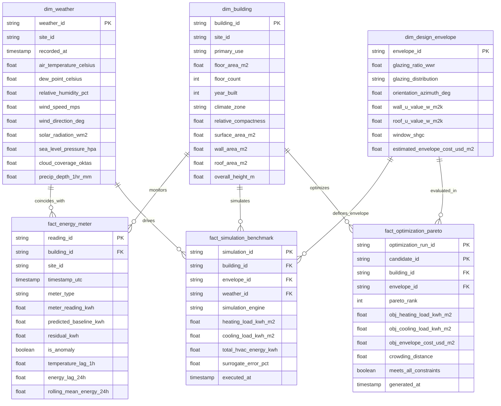

# Stage 4: Database Design & Data Modeling Specification
**ML Diploma Graduation Project | System Analysis & Design**  
**Team Name:** CloudXAi  
**Team Code:** NHA-5-165  
**Project Title:** AI-Based Building Energy Performance Evaluation & Design Optimization  
**Document Version:** v1.0  

---

## 1. Data Modeling Strategy & Rationale

Building performance analytics inherently spans two fundamentally different temporal dimensions:
1. **Static Architectural Configurations:** Building massing, orientation, compactness, and envelope materials that remain constant over years.
2. **High-Frequency Dynamic Telemetry:** Hourly weather conditions, solar angles, and smart meter energy consumption readings that change constantly.

To achieve analytical efficiency, eliminate redundancy, and support sub-second SQL queries across millions of records in both **DuckDB** and **Amazon Athena**, CloudXAi adopts a **Dimensional Star Schema** following the Kimball methodology.

---

## 2. Entity-Relationship Diagram (ERD)



---

## 3. Physical Data Dictionaries

### 3.1 Dimension Table: `dim_building`
Represents the structural and geometric attributes of buildings in the lakehouse.

| Column Name | SQL Type | Nullable | Key | Units / Domain | Description |
| :--- | :--- | :--- | :--- | :--- | :--- |
| `building_id` | `VARCHAR(32)` | No | PK | String Identifier | Unique building identifier (e.g., `BLD_0142`). |
| `site_id` | `VARCHAR(16)` | No | Index | String Identifier | Coincident meteorological station / campus site. |
| `primary_use` | `VARCHAR(64)` | No | - | Categorical | Primary occupancy type (Office, Education, Residential). |
| `floor_area_m2` | `DOUBLE` | No | - | $\text{m}^2$ ($> 0$) | Total conditioned floor area in square meters. |
| `floor_count` | `INTEGER` | Yes | - | Counts ($\ge 1$) | Number of above-ground floors. |
| `year_built` | `INTEGER` | Yes | - | Year ($1850–2026$) | Year of construction completion. |
| `climate_zone` | `VARCHAR(16)` | No | - | ASHRAE 90.1 Zone | Climate zone classification (e.g., `1A`, `3C`, `5B`). |
| `relative_compactness` | `DOUBLE` | No | - | Ratio ($0.5–1.1$) | Ratio of building surface area to volume relative to cube. |
| `surface_area_m2` | `DOUBLE` | No | - | $\text{m}^2$ ($> 0$) | Total exterior envelope surface area. |
| `wall_area_m2` | `DOUBLE` | No | - | $\text{m}^2$ ($> 0$) | Total opaque exterior wall area. |
| `roof_area_m2` | `DOUBLE` | No | - | $\text{m}^2$ ($> 0$) | Total roof exterior surface area. |
| `overall_height_m` | `DOUBLE` | No | - | Meters ($> 0$) | Total building height from grade to roof. |

### 3.2 Dimension Table: `dim_weather`
Chronological meteorological station telemetry synchronized with site locations.

| Column Name | SQL Type | Nullable | Key | Units / Domain | Description |
| :--- | :--- | :--- | :--- | :--- | :--- |
| `weather_id` | `VARCHAR(48)` | No | PK | Hash Key | Unique composite key (`site_id_timestamp`). |
| `site_id` | `VARCHAR(16)` | No | FK / Part | String Identifier | Geographic site identifier. |
| `recorded_at` | `TIMESTAMP` | No | Index | ISO 8601 UTC | Coordinated Universal Time of observation. |
| `air_temperature_celsius` | `DOUBLE` | No | - | $^\circ\text{C}$ ($-40\text{ to }55$) | Dry-bulb ambient air temperature. |
| `dew_point_celsius` | `DOUBLE` | Yes | - | $^\circ\text{C}$ | Ambient dew point temperature. |
| `relative_humidity_pct` | `DOUBLE` | No | - | Percentage ($0–100$) | Atmospheric relative humidity. |
| `wind_speed_mps` | `DOUBLE` | No | - | $\text{m/s}$ ($\ge 0$) | Surface horizontal wind velocity. |
| `wind_direction_deg` | `DOUBLE` | Yes | - | Degrees ($0–360$) | Compass direction from which wind originates. |
| `solar_radiation_wm2` | `DOUBLE` | Yes | - | $\text{W/m}^2$ ($\ge 0$) | Global horizontal solar irradiance. |
| `sea_level_pressure_hpa` | `DOUBLE` | Yes | - | $\text{hPa}$ ($900–1080$) | Atmospheric pressure adjusted to sea level. |
| `cloud_coverage_oktas` | `DOUBLE` | Yes | - | Oktas ($0–8$) | Sky cloud opacity fraction. |
| `precip_depth_1hr_mm` | `DOUBLE` | Yes | - | $\text{mm}$ ($\ge 0$) | Liquid precipitation accumulated in prior hour. |

### 3.3 Dimension Table: `dim_design_envelope`
Parametric envelope configurations for design optimization and surrogate exploration.

| Column Name | SQL Type | Nullable | Key | Units / Domain | Description |
| :--- | :--- | :--- | :--- | :--- | :--- |
| `envelope_id` | `VARCHAR(32)` | No | PK | Hash Identifier | Unique hash of envelope parameter vector. |
| `glazing_ratio_wwr` | `DOUBLE` | No | - | Ratio ($0.0–0.50$) | Total window-to-wall ratio of the building facade. |
| `glazing_distribution` | `VARCHAR(32)` | No | - | Categorical | Distribution (Uniform, South-Biased, North-Biased). |
| `orientation_azimuth_deg` | `DOUBLE` | No | - | Degrees ($0–360$) | Building orientation azimuth ($0^\circ = \text{North}, 180^\circ = \text{South}$). |
| `wall_u_value_w_m2k` | `DOUBLE` | No | - | $\text{W/m}^2\text{K}$ | Overall thermal transmittance of exterior walls. |
| `roof_u_value_w_m2k` | `DOUBLE` | No | - | $\text{W/m}^2\text{K}$ | Overall thermal transmittance of roof insulation. |
| `window_shgc` | `DOUBLE` | No | - | Fraction ($0.1–0.9$) | Solar Heat Gain Coefficient of fenestration. |
| `estimated_envelope_cost_usd_m2`| `DOUBLE` | No | - | $\text{USD/m}^2$ | Estimated construction cost per envelope area. |

### 3.4 Fact Table: `fact_energy_meter`
High-frequency operational meter readings joined with engineered time-series features.

| Column Name | SQL Type | Nullable | Key | Units / Domain | Description |
| :--- | :--- | :--- | :--- | :--- | :--- |
| `reading_id` | `VARCHAR(64)` | No | PK | Hash Key | Unique reading identifier. |
| `building_id` | `VARCHAR(32)` | No | FK | Reference | Foreign key to `dim_building`. |
| `site_id` | `VARCHAR(16)` | No | Part | Partition Key | Geographic partition identifier. |
| `timestamp_utc` | `TIMESTAMP` | No | Index / Part | ISO 8601 UTC | Hourly observation timestamp. |
| `meter_type` | `VARCHAR(32)` | No | - | Categorical | `electricity`, `chilledwater`, `steam`, `hotwater`. |
| `meter_reading_kwh` | `DOUBLE` | No | - | $\text{kWh}$ ($\ge 0$) | Actual metered energy consumption. |
| `predicted_baseline_kwh` | `DOUBLE` | Yes | - | $\text{kWh}$ | ML model estimated weather-normalized baseline. |
| `residual_kwh` | `DOUBLE` | Yes | - | $\text{kWh}$ | Operational residual ($\text{Actual} - \text{Predicted}$). |
| `is_anomaly` | `BOOLEAN` | No | - | `TRUE` / `FALSE` | Flag set if residual exceeds $2.5\sigma$ threshold. |
| `temperature_lag_1h` | `DOUBLE` | Yes | - | $^\circ\text{C}$ | Ambient temperature from preceding hour. |
| `energy_lag_24h` | `DOUBLE` | Yes | - | $\text{kWh}$ | Energy consumption from same hour on prior day. |
| `rolling_mean_energy_24h`| `DOUBLE` | Yes | - | $\text{kWh}$ | Trailing 24-hour moving average of consumption. |

### 3.5 Fact Table: `fact_simulation_benchmark`
Ground-truth simulation runs executed via EnergyPlus or extracted from DOE Reference Buildings.

| Column Name | SQL Type | Nullable | Key | Units / Domain | Description |
| :--- | :--- | :--- | :--- | :--- | :--- |
| `simulation_id` | `VARCHAR(32)` | No | PK | String Identifier | Unique simulation experiment identifier. |
| `building_id` | `VARCHAR(32)` | No | FK | Reference | Foreign key to `dim_building`. |
| `envelope_id` | `VARCHAR(32)` | No | FK | Reference | Foreign key to `dim_design_envelope`. |
| `weather_id` | `VARCHAR(48)` | No | FK | Reference | Foreign key to `dim_weather`. |
| `simulation_engine` | `VARCHAR(32)` | No | - | Categorical | `EnergyPlus_v23.2`, `DOE_Ref_Model`. |
| `heating_load_kwh_m2` | `DOUBLE` | No | - | $\text{kWh/m}^2$ | Annualized heating demand per conditioned area. |
| `cooling_load_kwh_m2` | `DOUBLE` | No | - | $\text{kWh/m}^2$ | Annualized cooling demand per conditioned area. |
| `total_hvac_energy_kwh` | `DOUBLE` | No | - | $\text{kWh}$ | Total mechanical conditioning electricity and fuel. |
| `surrogate_error_pct` | `DOUBLE` | Yes | - | Percentage | Relative error between ML surrogate and simulation. |
| `executed_at` | `TIMESTAMP` | No | - | ISO 8601 UTC | Timestamp of physics simulation completion. |

### 3.6 Fact Table: `fact_optimization_pareto`
Optimal design candidates discovered by the NSGA-II multi-objective optimization engine.

| Column Name | SQL Type | Nullable | Key | Units / Domain | Description |
| :--- | :--- | :--- | :--- | :--- | :--- |
| `optimization_run_id` | `VARCHAR(32)` | No | Composite PK | Hash Identifier | Unique identifier for the genetic algorithm run. |
| `candidate_id` | `VARCHAR(32)` | No | Composite PK | String | Unique candidate ID within the population (e.g., `C_042`). |
| `building_id` | `VARCHAR(32)` | No | FK | Reference | Baseline building reference. |
| `envelope_id` | `VARCHAR(32)` | No | FK | Reference | Foreign key to evaluated envelope parameters. |
| `pareto_rank` | `INTEGER` | No | - | Integer ($\ge 1$) | Non-dominated sorting rank ($1 = \text{Optimal Frontier}$). |
| `obj_heating_load_kwh_m2`| `DOUBLE` | No | - | $\text{kWh/m}^2$ | Objective 1 value (Annual heating load). |
| `obj_cooling_load_kwh_m2`| `DOUBLE` | No | - | $\text{kWh/m}^2$ | Objective 2 value (Annual cooling load). |
| `obj_envelope_cost_usd_m2`| `DOUBLE` | No | - | $\text{USD/m}^2$ | Objective 3 value (Envelope construction cost). |
| `crowding_distance` | `DOUBLE` | No | - | Distance Metric | Diversity metric in objective space. |
| `meets_all_constraints` | `BOOLEAN` | No | - | `TRUE` / `FALSE` | Validates adherence to all architectural bounds. |
| `generated_at` | `TIMESTAMP` | No | - | ISO 8601 UTC | Timestamp of optimization execution. |

---

## 4. Partitioning & Storage Layout

To guarantee high query throughput in both DuckDB and Amazon Athena, Parquet files are partitioned hierarchically on disk and in S3:

```
s3://building-energy-lakehouse-nha165/curated/
│
├── dim_building/
│   └── dim_building.parquet
│
├── dim_weather/
│   └── site_id=site_01/
│       └── year=2017/
│           └── weather_data.parquet
│
├── fact_energy_meter/
│   └── site_id=site_01/
│       └── year=2017/
│           └── meter_type=electricity/
│               └── readings.parquet
│
└── fact_optimization_pareto/
    └── run_date=2026-10-16/
        └── pareto_candidates.parquet
```
* **Partition Pruning:** SQL queries filtering by `site_id`, `year`, or `meter_type` read only the necessary Parquet file segments, minimizing I/O and query cost.
