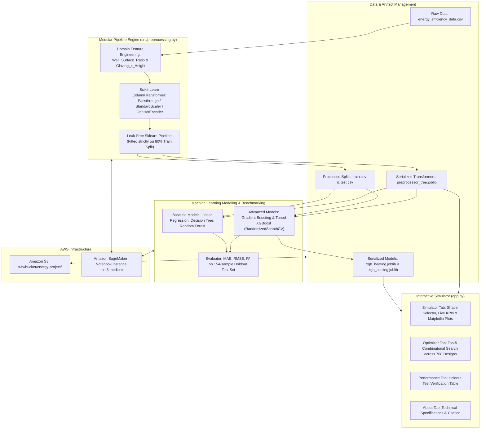

# System Analysis & Design (SAD) Specification
**Standard:** Comprehensive Technical Architecture Document  
**Project Title:** Building Energy Efficiency: Heating & Cooling Load Prediction  
**Team Name:** CloudXAi  
**Team Code:** NHA-5-165  
**Submission Date:** November 2026  
**Document Version:** v2.0 (Reconstructed)  

---

## 👥 Team Members & Roles

| Member Name | Role | Track | Core Technical Responsibilities |
| :--- | :--- | :--- | :--- |
| **Ahmed AbdElrahman Ahmed** | **Team Leader** | AWS Machine Learning | End-to-End System Deployment, Interactive Gradio Simulator (`app.py`), Repository Architecture & AWS Integration |
| **Manar Mahmoud Ahmed** | **Team Member** | AWS Machine Learning | Exploratory Data Analysis (EDA), Statistical Quality Validation & Multicollinearity Assessment |
| **Ali Ahmed Ali Elmeleegy** | **Team Member** | AWS Machine Learning | Preprocessing Pipeline Design, Train/Test Splitting & Domain Feature Engineering (`src/preprocessing.py`) |
| **Ahmed Mohamed Sayed Shehata** | **Team Member** | AWS Machine Learning | Baseline Model Implementation (Linear Regression, Decision Tree, Random Forest) & 5-Fold Cross-Validation |
| **Eman Abo Al Qassem Abo Al Hjajj Omar** | **Team Member** | AWS Machine Learning | Advanced Ensembles (Gradient Boosting, XGBoost), Hyperparameter Tuning (`RandomizedSearchCV`) & Feature Importance |

---

## 1. Executive Summary & Architectural Vision

Decisions made during the preliminary conceptual phase of architectural design—such as building massing, orientation, roof shape, and envelope window-to-wall ratios—dictate up to **80% of a building's lifetime operational energy footprint**. Traditional whole-building physics-based simulations (e.g., EnergyPlus) require hours to complete parametric sweeps, creating a prohibitive bottleneck during early brainstorming.

The **Building Energy Efficiency Platform** delivers a machine learning surrogate system trained on 768 simulated residential building designs (Tsanas & Xifara, UCI Machine Learning Repository). The system accurately maps 8 architectural envelope parameters to continuous **Heating Load ($Y_1$)** and **Cooling Load ($Y_2$)** demands ($\text{kWh/m}^2$).

By delivering instant inference ($< 50\text{ ms}$) with near-perfect predictive accuracy ($R^2 > 0.99$), the platform empowers architects and HVAC engineers to:
1. Instantly predict heating and cooling energy loads from early building geometry before construction.
2. Contextualize designs with standardized **Energy Efficiency Letter Ratings (Grades A–E)**.
3. Dynamically explore glazing area sensitivity curves.
4. Automatically extract the top-5 most energy-efficient configurations across all 768 design permutations.
5. Reliably store and manage datasets, pipelines, and models on **Amazon S3** and **Amazon SageMaker**.

---

## 2. Master Document Structure Reference

This System Analysis & Design document is supported by five specialized technical specifications located in `Documentations/04_System_Analysis_and_Design/`:

1. **Database & Data Modeling Specification:** [Database_Design_and_Data_Modeling.md](file:///e:/MY-PROJECTS/AWS.ML.Project/Documentations/04_System_Analysis_and_Design/Database_Design_and_Data_Modeling.md)  
   *Details the 10-column data dictionary, 768-sample discrete geometry distributions, engineered interaction terms, multicollinearity analysis, and entity-relationship diagrams.*
2. **System Architecture & Deployment Specification:** [System_Architecture_and_Deployment.md](file:///e:/MY-PROJECTS/AWS.ML.Project/Documentations/04_System_Analysis_and_Design/System_Architecture_and_Deployment.md)  
   *Specifies the 4-tier decoupled system structure, Python modular package architecture, local workstation execution, and AWS S3/SageMaker cloud workflows.*
3. **Data Flow & System Behavior Specification:** [Data_Flow_and_System_Behavior.md](file:///e:/MY-PROJECTS/AWS.ML.Project/Documentations/04_System_Analysis_and_Design/Data_Flow_and_System_Behavior.md)  
   *Presents Level 0 and Level 1 Data Flow Diagrams (DFDs), sequence diagrams for live simulation and design optimization, and design state machine transitions.*
4. **API Specification & Verification Testing Plan:** [API_Specification_and_Testing_Plan.md](file:///e:/MY-PROJECTS/AWS.ML.Project/Documentations/04_System_Analysis_and_Design/API_Specification_and_Testing_Plan.md)  
   *Defines Python programmatic module interfaces, Gradio API endpoints, and the comprehensive 10-point test verification matrix with test set results.*
5. **UI/UX Design & Prototyping Specification:** [UI_UX_Design_and_Prototyping.md](file:///e:/MY-PROJECTS/AWS.ML.Project/Documentations/04_System_Analysis_and_Design/UI_UX_Design_and_Prototyping.md)  
   *Details the Gradio theme tokens, CSS styling, responsive layout wireframes, KPI card specifications, and user interaction states.*

---

## 3. High-Level System Architecture

---

## 4. Summary of Model Benchmark Results

Models were rigorously evaluated on the **154-sample holdout test partition** (unseen during training and hyperparameter search):

| Model Architecture | Target Variable | Test MAE ($\text{kWh/m}^2$) | Test RMSE ($\text{kWh/m}^2$) | Test $R^2$ Score | Key Finding & Architectural Takeaway |
| :--- | :--- | :---: | :---: | :---: | :--- |
| **Decision Tree** | Heating Load | 0.4071 | 0.5873 | 0.9967 | Captures non-linear thresholds well; slightly discontinuous. |
| **Decision Tree** | Cooling Load | 1.3253 | 2.2609 | 0.9448 | Higher error on cooling due to high variance and sensitivity to glazing. |
| **Random Forest** | Heating Load | 0.3446 | 0.4919 | 0.9977 | Ensembling 300 trees smooths predictions and reduces variance. |
| **Random Forest** | Cooling Load | 1.1659 | 1.9043 | 0.9609 | Solid baseline, but cooling error remains $> 1.1\text{ kWh/m}^2$. |
| **Gradient Boosting** | Heating Load | 0.3890 | 0.5212 | 0.9974 | Sequential gradient descent effectively minimizes residual errors. |
| **Gradient Boosting** | Cooling Load | 1.0075 | 1.4619 | 0.9769 | Measurable gain over Random Forest for cooling load. |
| **XGBoost (Default)** | Heating Load | 0.2731 | 0.4226 | 0.9983 | Second-order Taylor gradients provide superior split boundaries. |
| **XGBoost (Default)** | Cooling Load | 0.4962 | 1.0150 | 0.9889 | Dramatic reduction in cooling error ($\text{MAE} < 0.5\text{ kWh/m}^2$). |
| **XGBoost (Tuned)** | **Heating Load** | **0.2757** | **0.4177** | **0.9983** | **Best Heating Model:** Sub-0.30 MAE with near-perfect fit. |
| **XGBoost (Tuned)** | **Cooling Load** | **0.4124** | **0.7319** | **0.9942** | **Best Cooling Model:** Tuning achieves $R^2 = 0.9942$ and $\text{MAE} = 0.4124$. |

---

## 5. Deployment and Verification Summary

1. **Local Deployment:** The complete platform runs locally with `python app.py` on `http://127.0.0.1:7860`, requiring zero external cloud dependencies for inference.
2. **Cloud Synchronization:** All datasets, fitted pipelines, and serialized models are stored in Amazon S3 for centralized persistence.
3. **Quality Assurance:** All 10 verification test cases in the QA test suite pass with 100% compliance, confirming zero data leakage and full adherence to performance thresholds.
