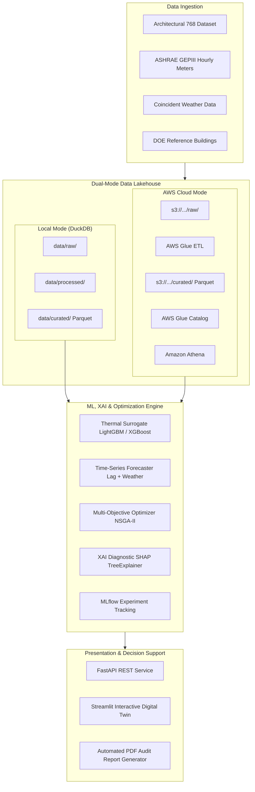

# System Analysis & Design (SAD) Specification
**Standard:** Comprehensive Technical Architecture Document  
**Project Title:** AI-Based Building Energy Performance Evaluation & Design Optimization  
**Team Name:** CloudXAi  
**Team Code:** NHA-5-165  
**Submission Date:** October 2026  
**Document Version:** v1.0  

---

## 👥 Team Members (AI Track)

| Member Name | Role | Track |
| :--- | :--- | :--- |
| **Ahmed AbdElrahman Ahmed** | Team Leader | AI / Machine Learning |
| **Ahmed Mohamed Sayed Shehata** | Team Member | AI / Machine Learning |
| **Eman Abo Al Qassem Abo Al Hjajj Omar** | Team Member | AI / Machine Learning |
| **Manar Mahmoud Ahmed** | Team Member | AI / Machine Learning |
| **Ali Ahmed Ali Elmeleegy** | Team Member | AI / Machine Learning |

---

## 1. Executive Problem Statement & Architectural Objectives

Early architectural decisions (massing, orientation, window-to-wall ratio, insulation) permanently dictate up to **80% of a building's lifetime energy consumption**. Traditional whole-building physics simulations (EnergyPlus) require hours to run parametric sweeps, creating a prohibitive bottleneck during early conceptual design workshops.

**CloudXAi** resolves this friction by delivering an end-to-end, decision-support platform that combines:
1. **Sub-second ML Surrogate Modeling:** Predicting Heating Load and Cooling Load in $< 250\text{ ms}$ with $R^2 \ge 0.95$.
2. **Weather-Aware Operational Energy Forecasting:** Time-series operational predictions on the ASHRAE GEPIII benchmark conforming to ASHRAE Guideline 14 standards ($\text{CV(RMSE)} \le 15\%$).
3. **Multi-Objective Genetic Optimization (NSGA-II):** Discovering non-dominated Pareto frontiers balancing energy efficiency, thermal comfort, and envelope construction budget.
4. **Explainable AI (SHAP TreeExplainer):** Diagnosing the exact physical drivers of energy behavior.
5. **Dual-Mode Portability:** Operating seamlessly on local workstations (DuckDB + Parquet) and deploying to AWS Cloud (S3 + Glue + Athena) with zero code rewrites.

---

## 2. Master Document Structure Reference

This System Analysis & Design document is partitioned into five specialized engineering modules:

1. **Architecture & Deployment:** [System_Architecture_and_Deployment.md](file:///e:/MY-PROJECTS/AWS.ML.Project/Documentations/04_System_Analysis_and_Design/System_Architecture_and_Deployment.md)  
   *Details the 4-tier decoupled component model, Dual-Mode execution profiles (Local vs. AWS), and Docker deployment.*
2. **Database & Data Modeling:** [Database_Design_and_Data_Modeling.md](file:///e:/MY-PROJECTS/AWS.ML.Project/Documentations/04_System_Analysis_and_Design/Database_Design_and_Data_Modeling.md)  
   *Presents the Kimball Dimensional Star Schema (`dim_building`, `dim_weather`, `dim_design_envelope`, `fact_energy_meter`, `fact_simulation_benchmark`, `fact_optimization_pareto`), full ERD, and Parquet partitioning strategy.*
3. **Data Flow & Behavior:** [Data_Flow_and_System_Behavior.md](file:///e:/MY-PROJECTS/AWS.ML.Project/Documentations/04_System_Analysis_and_Design/Data_Flow_and_System_Behavior.md)  
   *Contains Level 0 & Level 1 DFDs, Sequence Diagrams for optimization and forecasting, Activity Diagrams for ETL and NSGA-II, State Machine, and Class Diagram.*
4. **UI/UX & Prototyping:** [UI_UX_Design_and_Prototyping.md](file:///e:/MY-PROJECTS/AWS.ML.Project/Documentations/04_System_Analysis_and_Design/UI_UX_Design_and_Prototyping.md)  
   *Specifies visual wireframes for all 5 dashboard screens, design tokens, color palette, and accessibility compliance.*
5. **API & Testing Plan:** [API_Specification_and_Testing_Plan.md](file:///e:/MY-PROJECTS/AWS.ML.Project/Documentations/04_System_Analysis_and_Design/API_Specification_and_Testing_Plan.md)  
   *Defines OpenAPI REST endpoints (`/predict/thermal-load`, `/predict/energy-forecast`, `/optimize/pareto`, `/explain/shap`), request/response JSON schemas, and the 4-tier testing pyramid.*

---

## 3. High-Level Architecture Overview

---

## 4. Key Architectural Guarantees

| Quality Attribute | Architectural Guarantee | Verification Method |
| :--- | :--- | :--- |
| **Portability** | Zero vendor lock-in. Runs locally on DuckDB with zero cloud credentials, switches to AWS via `.env`. | Automated CI test matrix executing local and cloud profiles. |
| **Inference Latency** | Single-instance prediction in $< 250\text{ ms}$; 50-point Pareto optimization in $< 3.0\text{ seconds}$. | Automated latency profiling script. |
| **Model Accuracy** | $R^2 \ge 0.95$ for thermal loads; ASHRAE Guideline 14 compliance ($\text{CV(RMSE)} \le 15.0\%$, $\text{NMBE} \le \pm 5.0\%$). | MLflow evaluation benchmarks against holdout partitions. |
| **Data Integrity** | Strict schema validation, unit standardization, and quarantine routing for corrupt records. | PyTest validation assertions and quarantine log checks. |
| **Explainability** | Full local feature attribution via exact game-theoretic Shapley values with zero explainability leakage. | SHAP additivity assertion: $f(x) = E[f(x)] + \sum \phi_i$. |
| **Deployment** | Reproducible multi-container orchestration with Docker and Docker Compose. | `docker-compose up` smoke test in CI pipeline. |
