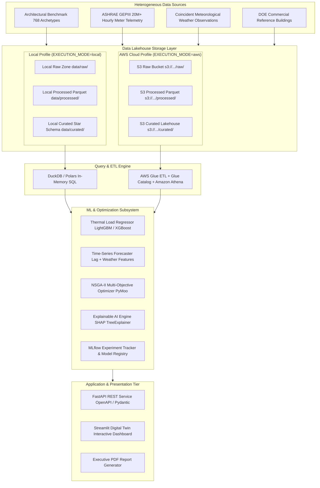
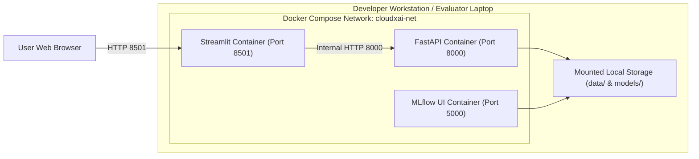
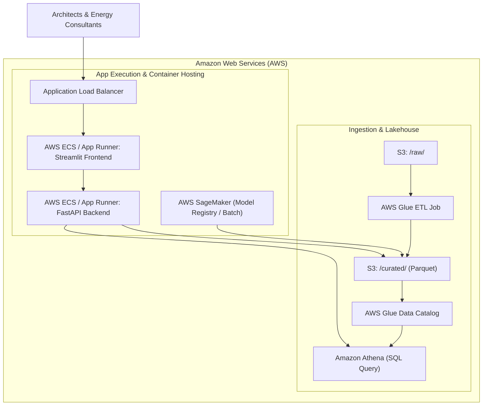

# Stage 4: System Architecture & Deployment Specification
**ML Diploma Graduation Project | System Analysis & Design**  
**Team Name:** CloudXAi  
**Team Code:** NHA-5-165  
**Project Title:** AI-Based Building Energy Performance Evaluation & Design Optimization  
**Document Version:** v1.0  

---

## 1. Architectural Vision & Design Principles

The **CloudXAi** architecture is designed around three non-negotiable principles:
1. **Dual-Mode Parity (Zero Vendor Lock-In):** The entire system must function seamlessly on a developer's local machine without internet or AWS account dependencies, while being fully deployable to AWS using native cloud services.
2. **Domain-Separated Workloads:** Explicit separation between architectural thermal-load estimation ($\text{kWh/m}^2$), operational meter electricity consumption ($\text{kWh}$), and physics-based EnergyPlus ground-truth verification.
3. **Decoupled 4-Tier Component Architecture:** Clear boundary isolation between Data Storage & Lakehouse, Processing & Query Engine, Machine Learning & Optimization, and the Presentation Tier.

---

## 2. High-Level Dual-Mode System Architecture

The following diagram illustrates how the abstract storage and compute interfaces decouple the application logic from the underlying execution environment:

---

## 3. Detailed Component Breakdown (4-Tier Architecture)

### Tier 1: Ingestion & Storage Abstraction Tier
* **Data Access Layer (DAL):** Implements a unified Python repository pattern (`StorageRepository`). When reading or writing datasets, the application calls `get_table(table_name)` without knowing whether the underlying target is a local file path (`data/curated/dim_building.parquet`) or an Amazon S3 URI (`s3://building-energy-lakehouse-nha165/curated/dim_building/`).
* **Columnar Storage:** All processed and curated tables are persisted as Snappy-compressed Apache Parquet, enforcing high compression ratios ($> 75\%$) and rapid columnar predicate pushdown.

### Tier 2: Transformation & Query Engine Tier
* **Local Mode:** Uses **DuckDB**, an embedded analytical SQL engine. DuckDB executes complex joins and aggregations directly on local Parquet files with zero operational overhead, providing full SQL compatibility with Amazon Athena.
* **AWS Cloud Mode:** Ingestion scripts copy files to S3. **AWS Glue Crawlers** automatically infer schemas and update the **AWS Glue Data Catalog**. Heavy distributed transformations run via Glue PySpark jobs, and analytical ad-hoc queries are executed via **Amazon Athena**.

### Tier 3: Machine Learning & Optimization Subsystem
* **Thermal Surrogate Estimator:** A multi-output ensemble (LightGBM / XGBoost) trained on geometric envelope features to predict Heating Load and Cooling Load in $< 250\text{ ms}$.
* **Time-Series Forecaster:** A temporal gradient-boosted forecaster trained on the ASHRAE GEPIII dataset, combining cyclical time features, temperature degree-days, and rolling weather windows.
* **Pareto Optimizer (PyMoo NSGA-II):** Evaluates candidate envelope configurations across 50 generations in $< 3.0\text{ seconds}$, powered by vectorized surrogate calls.
* **XAI Explainer (SHAP TreeExplainer):** Calculates exact game-theoretic feature attributions for any design instance in $< 300\text{ ms}$.
* **MLflow Tracking Server:** Logs parameters, metrics ($R^2$, $\text{MAE}$, $\text{CV(RMSE)}$), and model versions locally (`mlruns/`) or to an Amazon S3 backend.

### Tier 4: Presentation & API Tier
* **FastAPI Service:** Asynchronous, non-blocking REST API exposing typed endpoints validated via Pydantic v2 schemas.
* **Streamlit Digital Twin UI:** Multi-page dashboard with real-time reactive sliders, 2D/3D Plotly surfaces, and dynamic scenario comparison.
* **ReportLab PDF Exporter:** Generates self-contained, publication-ready PDF audit reports summarizing evaluated designs and Pareto recommendations.

---

## 4. System Deployment Models

### 4.1 Local Deployment Architecture (Docker & LocalStack)

The local deployment runs on any modern multi-core PC using Docker Compose:

* **Setup Command:** `docker-compose up --build -d`
* **Resource Profile:** 4 CPU cores, 4 GB RAM, 2 GB disk space.

### 4.2 AWS Production Deployment Architecture

For cloud deployment, the same containers deploy to AWS managed services with zero code rewrites:

---

## 5. Technology Stack Summary

| Layer | Local Profile Technology | AWS Cloud Profile Technology | Role / Responsibility |
| :--- | :--- | :--- | :--- |
| **Object / File Storage** | Local File System / MinIO | Amazon S3 | Immutable raw files, processed partitions, curated lakehouse. |
| **Data Catalog & SQL** | DuckDB + Polars | AWS Glue Catalog + Amazon Athena | High-speed analytical queries, schema discovery, partition pruning. |
| **ETL Engine** | DuckDB Python + PySpark Local | AWS Glue (PySpark Serverless) | Data validation, cleaning, unit standardization, lag engineering. |
| **Model Tracking** | MLflow Local Server (`mlruns/`) | AWS SageMaker / Managed MLflow | Hyperparameter logging, metrics comparison, model registry. |
| **Machine Learning** | LightGBM, XGBoost, Scikit-learn | Same + SageMaker Inference | Multi-target surrogate regression & operational energy forecasting. |
| **Optimization** | PyMoo (NSGA-II) | PyMoo (NSGA-II) | Multi-objective genetic optimization and Pareto frontier discovery. |
| **Explainable AI** | SHAP (TreeExplainer) | SHAP (TreeExplainer) | Game-theoretic local and global feature attribution. |
| **Backend REST API** | FastAPI + Uvicorn + Pydantic v2 | AWS ECS / App Runner | High-performance asynchronous API serving endpoints. |
| **Frontend UI** | Streamlit + Plotly | AWS ECS / App Runner | Interactive Digital Twin dashboard with 2D/3D visualizations. |
| **Containerization** | Docker + Docker Compose | AWS ECR + ECS Fargate | Reproducible application packaging and orchestration. |
