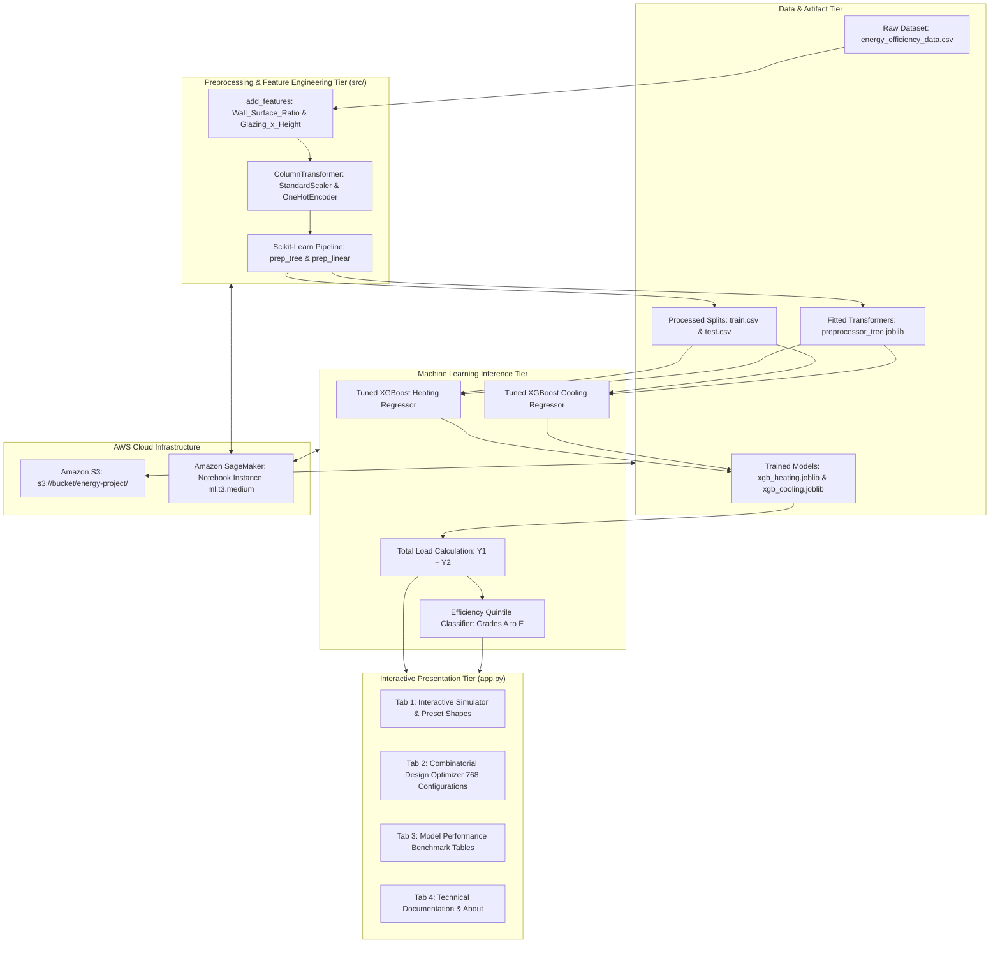

# Stage 4: System Architecture & Deployment Specification
**ML Diploma Graduation Project | System Analysis & Design**  
**Team Name:** CloudXAi  
**Team Code:** NHA-5-165  
**Project Title:** Building Energy Efficiency: Heating & Cooling Load Prediction  
**Document Version:** v2.0 (Reconstructed)  

---

## 1. Architectural Vision & Principles

The **Building Energy Efficiency Platform** is designed to provide high-accuracy, sub-second machine learning predictions of building heating and cooling loads directly from architectural geometry and envelope fenestration parameters. 

The architecture is guided by three engineering principles:
1. **Modularity & Reusability:** Core preprocessing and feature engineering logic is encapsulated within an isolated Python module (`src/preprocessing.py`), ensuring complete parity between training notebooks and deployment runtimes.
2. **Deterministic Reproducibility:** Fixed random seeds, leak-free pipeline fitting on training partitions only, and pinned dependency versions (`requirements.txt`) ensure reproducible results across local workstations and cloud environments.
3. **Decoupled 4-Tier Structure:** Distinct separation between Data Storage, Feature Transformation, Machine Learning Inference, and Presentation/Simulator tiers.

---

## 2. High-Level System Architecture Diagram



---

## 3. Tier-by-Tier Architectural Breakdown

### 3.1 Data & Storage Tier
* **Raw Storage:** `data/energy_efficiency_data.csv` (768 rows, 10 columns).
* **Processed Partition Storage:** `processed/train.csv` (614 rows) and `processed/test.csv` (154 rows).
* **Serialized Pipelines:** `processed/preprocessor_tree.joblib` and `processed/preprocessor_linear.joblib`.
* **Model Binaries:** `models/xgb_heating_load.joblib` and `models/xgb_cooling_load.joblib`.

### 3.2 Preprocessing & Feature Engineering Tier (`src/preprocessing.py`)
Encapsulates all transformations in a leak-free `sklearn.pipeline.Pipeline`:
```python
def add_features(X, engineer=True, drop=()):
    X = X.copy()
    if engineer:
        X["Wall_Surface_Ratio"] = X["Wall_Area"] / X["Surface_Area"]
        X["Glazing_x_Height"] = X["Glazing_Area"] * X["Overall_Height"]
    return X.drop(columns=list(drop))
```
* **Tree Pipeline (`prep_tree`):** Passthrough scaling and encoding, adding interaction features.
* **Linear Pipeline (`prep_linear`):** `StandardScaler` for numeric columns, `OneHotEncoder` for categorical orientations and glazing distributions.

### 3.3 Machine Learning Inference Tier
* Two dedicated tuned XGBoost regressors loaded into memory via `joblib`:
  - `m_heat`: Predicts Heating Load ($Y_1$, $\text{kWh/m}^2$).
  - `m_cool`: Predicts Cooling Load ($Y_2$, $\text{kWh/m}^2$).
* Execution latency is $< 20\text{ ms}$ for single-sample inference and $< 300\text{ ms}$ for the full 768-sample combinatorial sweep.

### 3.4 Presentation & Interactive Simulator Tier (`app.py`)
Built using Gradio with custom CSS styling (`teal` theme):
* **Geometry Presets:** 12 unique shapes sorted by relative compactness. Selecting a shape auto-populates exact geometry dimensions.
* **KPI Metrics:** Real-time calculation of Heating, Cooling, Total Load, and A–E Grade.
* **Visual Plots:** Matplotlib-rendered stacked bar chart (comparison against average and best design) and glazing sensitivity curve.
* **Design Optimizer:** In-memory Pandas vectorized filtering over the 768 designs.

---

## 4. Deployment Strategies

### 4.1 Local Standalone Deployment (Primary Development Mode)
Run directly on developer workstations without cloud connectivity:
```bash
# 1. Clone repository
git clone <repo-url>
cd AWS.ML.Project

# 2. Install pinned dependencies
pip install -r requirements.txt

# 3. Launch Gradio simulator
python app.py
```
The application initializes on `http://127.0.0.1:7860`, binding locally and offering immediate browser interactivity.

### 4.2 AWS Cloud Deployment

```
[ Local Developer Environment ]
             │
             │ AWS CLI / Boto3 Sync
             ▼
    [ Amazon S3 Bucket ]
    s3://<bucket>/energy-project/
    ├── raw/energy_efficiency_data.csv
    ├── processed/train.csv, test.csv
    └── models/xgb_*.joblib
             │
             │ S3 Sync / CloudWatch
             ▼
[ Amazon SageMaker Notebook Instance ]
  - Instance Type: ml.t3.medium (or ml.m5.large)
  - Execution of Energy_project.ipynb
  - Hyperparameter tuning with RandomizedSearchCV
             │
             │ Container Build (Dockerfile)
             ▼
[ Containerized Serving (Optional) ]
  - AWS App Runner / Amazon ECS / EC2
  - Port 7860 exposed via Application Load Balancer (ALB)
```

1. **Amazon S3 (Artifact Store):** Centralized versioned storage for datasets, preprocessors, and trained models.
2. **Amazon SageMaker (Training Environment):** Jupyter environment running on `ml.t3.medium` instances with Python 3.11+, providing collaborative notebook execution and cross-validation tracking.
3. **Containerized Hosting:** The application can be packaged into a lightweight Docker container (`python:3.12-slim`) and hosted on **AWS App Runner** or **Amazon EC2** for public web access.

---

## 5. Security, Reliability & Failure Modes

| Potential Failure Mode | Root Cause | Architectural Mitigation |
| :--- | :--- | :--- |
| **Model Incompatible Deserialization** | Mismatched scikit-learn or XGBoost runtime versions. | Pinned version specs in `requirements.txt`; validated compatibility tests in CI. |
| **Out-of-Bounds User Input** | User inputs physically impossible geometry values. | Input controls constrained to verified 12 shapes; dropdown selections prevent arbitrary inputs. |
| **Inference Timeout in Optimizer** | Searching across large design spaces. | Vectorized batch inference: all 768 designs pre-computed at application startup and cached in an in-memory DataFrame. |
| **S3 Access Denied** | Misconfigured IAM permissions. | Minimal least-privilege IAM policy granting `s3:GetObject` and `s3:PutObject` strictly on the project prefix. |
